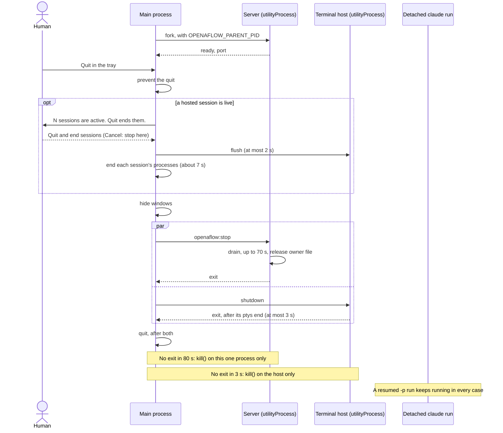

# Desktop shell

## What it is

`packages/desktop` is the Electron main process. It runs the production server bundle in a `utilityProcess`, opens the board in a plain window, keeps a tray icon, and owns the quit. A quit with a live hosted session asks first, and a confirm ends every process those sessions started. Start it with `pnpm build`, then `pnpm desktop`. Toasts are in [toasts.md](toasts.md). The installer, updates, and the first release are in [installer-and-updates.md](installer-and-updates.md).

## How it works

- **Layout.** Only `main.ts` and `*-main.ts` import `electron` or `electron-updater`. All logic sits in plain modules with fakes, and `no-electron.test.ts` holds this rule.
- **Start.** Name, `APP_ID`, data folder, single-instance lock. A second launch exits here and shows the first window. After the server failed for good, it makes the first copy quit and start fresh instead (see [installer-and-updates.md](installer-and-updates.md)). On `ready`: window and tray, notifier, updater, server.
- **Folders.** The shell data folder (installed: `%APPDATA%\OpenAFlow`, from `app.setName`) holds Chromium's data, the lock, and `window-state.json`. The server's config folder stays the server's own, so a shell and `pnpm dev` share it.
- **Log file.** `desktop.log` in the shell data folder (installed: `%APPDATA%\OpenAFlow\desktop.log`; `OPENAFLOW_DESKTOP_DATA_DIR` moves it). It holds each line the console shows, the server's too, with a time. At 256 KB it moves to `desktop.log.1`, so at most two files stay. In every line, the home folder becomes `~`, in any case, with either slash, with doubled backslashes, or URL-encoded as in a stack frame. A folder that goes on past the home with a sign and a letter or digit (`Name2`, `Name+old`, `Name(2)`) stays. A space swaps, because a folder with a space can't be told from prose: `Name Smith\x` reads `~ Smith\x`, which only mislabels it. A line that names a token is left out. An `Error` the shell itself logs keeps only its name. A server line is text by the time the shell reads it, so a server error keeps its message and stack as the server printed them. No code logs entry text on purpose, but a server error's message could quote what it read. The user's name can also stay where it isn't part of the home path, such as in a Claude project folder name (`C--Users-name-…`). A second launch writes nothing.
- **Port and token.** The shell sets no port and never holds the token. It reads the port from the server's ready message, and the page gets the token from the server.
- **Server host.** One restart after a failure. A failure is an exit outside a stop, a `fork` that throws, or no ready in 60 s. A second failure shows a native error box that names the Releases page, hides the window, checks once for an update, and then quits (see [installer-and-updates.md](installer-and-updates.md)). The box says the app checks only when a check runs. One helper, `hideWindows`, hides the windows for the quit, the failure, and a Restart now, and skips a destroyed window. 60 s of ready earns the restart back. A new port fires `onReady` again, and the window and notifier move. `send(m)` posts to the current server process, and drops the message when there is none. `onMessage(fn)` hears only the current process; its `reply` reaches the process that asked, and only while that process is current, so an answer never reaches a restarted server.
- **Server env.** The server gets the shell's env without `ELECTRON_RUN_AS_NODE`, plus `OPENAFLOW_PARENT_PID`, `OPENAFLOW_TERMINALS=1`, and `OPENAFLOW_HOOKS_PLUGIN` (the hooks plugin's absolute folder, unpackaged or packaged). An inherited value of any of these three, in any case, is dropped. `pnpm dev` and `pnpm start` set no `OPENAFLOW_TERMINALS`, so they have no terminal channel.
- **Window.** The normal Windows frame, no app menu, the page isolated and sandboxed, with no Node. Close hides it. Off-origin `http` and `https` links open in the system browser, and anything else opens nothing. A `--hidden` start shows only the tray.
- **Folder bridge.** The window's one preload, `dist/preload.cjs`, gives the page `window.openaflow.pickFolder()`, the terminal link's three calls, and `onQuitting` (below). It asks the main process on the IPC channel `openaflow:pick-folder`. Only the app window's main frame on the server's current origin may ask. Any other caller (another port or origin, `file:`, `about:blank`, a subframe, a call before the server is ready) gets a rejection with `forbidden`, and no dialog opens. The answer is the first path from the system folder dialog (`dialog.showOpenDialog`, owned by the app window), or `null` for a cancel. The page puts it in the Add repo field and posts nothing. A call while the dialog is open gets `null`. A dialog error rejects with `dialog failed` and is logged. The sender rule is one exported function, `senderAllowed`, which the terminal link uses too.
- **Terminal host** (full notes: [terminal-host.md](terminal-host.md)). After the server's first ready, the starter (`pty-host-starter.ts`) forks the pty host (`packages/pty-host`) in a second `utilityProcess`, `OpenAFlow terminal host`. Its env is the shell's, without `ELECTRON_RUN_AS_NODE`; `SystemRoot` stays. The protocol is in `pod-docs/sprints/host-core.md` (§4). Unpackaged, the bundle is `packages/pty-host/dist/pty-host.cjs`; packaged, `<resources>/pty-host/pty-host.cjs`, with node-pty beside it in `node_modules`. The starter:
  - Waits 20 s for `ready`. No ready in time: it kills the host and counts a crash. A start, snapshot, list, or kill before ready waits for it, across restarts too.
  - Keeps the live set from `started` and `exit`. An `exit` event goes to listeners once per session, only for an id that leaves the live set. `dispose(id)` posts `dispose` to a ready host and takes the id out of the live set, because the host sends no `exit` for it; with no ready host it sends nothing, since no host holds the session.
  - Watches the beat: 6 s without one logs `terminal host sent no beat for 6 s`; 11 s makes it `unresponsive`, once per spell, and the next beat makes it responsive. Unresponsive is only a report: requests still go out, and nothing kills the host.
  - Restarts a host that exits outside a stop (or whose `fork` throws) at once, up to 5 times in the app's life; a healthy run gives none back. Each crash reports the ids that were live, and rejects the requests the host will never answer with `terminal host exited`. After the fifth restart's host ends, it is `failed`: every later request rejects with `terminals unavailable`, and the board keeps running.
  - `stop()` sends `shutdown`, kills after 3 s, and never restarts. From the stop on, only the host's exit counts: a beat or a late `ready` reports nothing.
  - `flush()` asks a ready host to save every screen file. It resolves at the host's `flushed`, after 2 s (`FLUSH_WAIT_MS`), at a crash, or at the stop, and at once with no ready host. It never rejects. `held()` names the ids main holds: live, or with a start sent and no answer yet (waiting for their pid), test-hook starts included.
  - `desktop.log` gets `openaflow desktop: terminal host ready`, `… could not load node-pty: <error>`, `… exited with code <n>`, `… lost sessions: <ids>` (or `none`) at each crash, `… restarting (<n> restarts left)` (`1 restart left`), and `… failed for good: terminals are unavailable until the app restarts`.
- **Terminal link.** The preload adds `window.openaflow.connectTerminals(): Promise<void>`, `window.openaflow.onTerminalHost(fn)`, which returns a function that stops the calls, and `window.openaflow.terminalHostState()`. The last asks on `openaflow:terminal-host-state` and answers the host's state now: `starting` (before the first ready, and during a restart), `ready`, `unresponsive`, or `failed` (also after the quit's stop). The sender rule applies; any other caller gets a rejection with `forbidden`. `connectTerminals` asks on `openaflow:terminal-connect`. The folder bridge's sender rule applies; any other caller gets `forbidden`. Main makes a `MessageChannelMain`, posts one end to the host with `connect`, and sends the other to the caller's main frame. The preload posts it to the page as a `window` message `{ type: 'openaflow:terminal-port' }` with the port in `ports[0]`, and the promise resolves once that message has reached the page. Before the host is ready, the request waits up to 20 s, then rejects `terminals unavailable`; after `failed`, it rejects at once, and so does a new request once the quit has begun (one that already waits ends at its 20 s). An unresponsive host still gets the port. Every window hears `ready` (the first ready, and a beat after `unresponsive`), `unresponsive`, `restarted` (a restarted host is ready: old ports are dead, so connect again), and `failed`. The app window is the newest `BrowserWindow`, tracked in `terminal-port-main.ts` as window-main.ts makes it.
- **Server terminal link** (`terminal-relay.ts`, wired in `shell-main.ts`). The server and main talk over the server's parent port, in messages of type `openaflow:terminal` (`pod-docs/sprints/terminal-tab.md` §2). The server's `start {req, spec}`, `list {req}`, and `dispose {id}` go to the starter. Main answers each `start` once, with `started {req, id, pid}` or `start-failed {req, id, error}`: the host's word, `terminals unavailable` after `failed`, or `terminal host exited` for a crash during the start. A start before the host is ready waits. Each `list` gets `list` or `list-failed`. Each session's `exit {id, exitCode}` goes once, after its `started`, and each host crash sends `lost {ids}` with the ids that were live (empty too). Answers go only to the server process that asked; `exit` and `lost` go to the current one, and nothing waits for a server that is gone. Once the quit stops the starter, main sends nothing more. A bad shape or another op (the server can't `kill`) changes nothing and logs one line, `openaflow desktop: terminal link ignored a bad message: <reason>`, which never holds the message itself.
  - The session roster (`session-roster.ts`) hears every start (`starting`, with its stop), `started` (the pid), `start-failed` and `exit` (ended), and each crash's lost ids (each swept). An exit that comes before its `started` answer reaches the roster after the start, as it reaches the server.
  - `start` may carry `stop` (`pod-docs/sprints/session-life.md` §3): 1–32 strings, each at most 1,024 characters, the first absolute. A bad one: the start goes on with no stop, and one line, `openaflow desktop: terminal link dropped a bad stop, so the session starts with none: <reason>`, with no argv in it. The stop never goes to the host.
  - `sweep {sessions}`: every id must be a session id (`[a-z0-9-]{1,64}`), and each stop as above, or the whole message is a bad message and nothing is swept. Main skips the ids it holds (`held()`, and starts in flight in the relay), and the roster skips its live, pid-waiting, and already-swept ids. The rest are swept (§7).
  - `labels {labels}`: the newest list replaces the last; at most 100, control characters (C0, DEL, C1) dropped, each cut to 120 characters. After the server is gone, the quit question uses the last list.
  - From a quit's confirm (or `endSessions()` true, or a Windows `session-end`), main sends the server no `exit` or `lost`, so the next start's reconcile reads those sessions `stopped · app closed`. Answers to the server's own requests still go.
- **Quit with sessions** (`quit-flow.ts`, glue in `quit-main.ts`, wired in `shell-main.ts`). The roster's live sessions (live, or waiting for their pid) decide, at each quit:
  - None live: today's flow (hide, then the server and host stops together).
  - Else the native box, owned by the window when it shows: message `1 session is active. Quit ends it.` or `N sessions are active. Quit ends them.`; detail: one label a line (no label: `a session`), at most 10, then `and N more`; buttons `Quit and end sessions` and `Cancel`; Cancel is the default and the cancel button. Only the first button ends anything. Cancel, or a box that fails (logged `quit question failed, so nothing ends`), changes nothing, and the next quit asks again. A quit while the box is open, or while the ends run, is ignored.
  - Confirm: the relay goes quiet, every window gets `openaflow:quitting {count}` (the page's `window.openaflow.onQuitting(fn)`, which returns a function that stops the calls), the roster's `endAll()` runs (the host's `flush`, at most 2 s, then each session's end, all at once, about 7 s), then the windows hide and today's stops run. Main logs `openaflow desktop: quit asked about <n> sessions: <answer>`.
  - After the server failed for good, a quit asks nothing: the error box came first, and the sessions end as after a confirm.
  - `ctx.endSessions()` (for Restart now): no live session → `true`, no box. Else the same box: Cancel → `false`; confirm → the overlay event and `endAll()`, then `true`, and the quit after it asks nothing (no session is live any more). A quit during that box is ignored, so the caller quits its own way.
  - `session-end` (Windows shutdown): no box; the relay goes quiet and `endAll()` starts; nothing waits.
  - Ending (`session-ender.ts`, `proc-scan.ts`): on Linux the session's stop command, then SIGHUP, SIGTERM, and SIGKILL to its process group, its descendants, and every process whose env holds `OPENAFLOW_RUN=<id>`; never pid 1 or below, main, its parent, the host, the current server, or a reused pid. On Windows a Job Object per session (`windows-jobs.ts`, one hidden `powershell.exe` child of main), then `taskkill /T /F`. The Job Object helper starts only on Windows.
  - A resumed `claude -p` run is never a hosted session, so no quit ends it.
- **Test hooks.** A bundle built with `__OPENAFLOW_TEST_HOOKS__` sets `globalThis.__openaflowTest.terminals` (`start(spec)`, `snapshot(id)`, `list()`, `kill(id)`, `hostPid()`, the current host's process ID) and `globalThis.__openaflowTest.quit`. Such a build never opens the quit box: it answers `end`, or `cancel` for the one question after `quit.answer('cancel')`, so the harness's `close()` still quits. Only the Electron harness (`test/electron-harness.ts`) and `pnpm package --test-hooks` build it; every other bundle drops the code, and `release:check` refuses a `main.cjs` that names it.
- **Tray.** Open and Quit. After the server failed for good, Open starts a fresh copy, as a second launch does. The dot comes from `bus.onAttention`.
- **Login item.** No part of the app turns it on today: it moves to a settings page ([decision](../decisions.md#2026-11-04--start-at-login-leaves-the-tray-menu-human-decision)). `createLoginItem` stays for that page. A login item from an earlier version still starts the app with `--hidden`, in the tray with no window. Uninstall still removes it.

**Example, measured on this machine with `pnpm test:electron`.** A resumed `fake-claude` runs behind a `claude.cmd`.

- A normal quit: the main process and the server end, the owner file goes, and the fake lives.
- `taskkill /F` on the main process: the server dies with it before its parent watch runs, and the owner file stays for the next start. The fake lives.
- `taskkill /F` on the server: a new one is ready within seconds. A second kill within 60 s ends in `failed`, with no third start. The fake lives.

**Logic lives in:** `packages/desktop/src/server-host.ts`, `pty-host-starter.ts`, `terminal-relay.ts`, `terminal-port.ts`, `quit-flow.ts`, `session-roster.ts`, `session-ender.ts`, `proc-scan.ts`, `windows-jobs.ts`, `window-rules.ts`, `folder-bridge.ts`, and `shell-main.ts`.

## Why it's this way

- **Quit never kills a resumed run.** The research suggested a process-tree kill or a Job Object. Both would stop the detached `claude -p` runs that the board starts on purpose. Trade-off: a stuck server waits up to 80 s before its kill. See the [plan](../plans/windows-app.md#key-decisions).
- **A quit ends hosted sessions, after a question.** A hosted session's terminal lives in the host, which the quit stops; its programs (dev servers too) would otherwise run on with no terminal. So a confirmed quit ends each one's whole tree, and only theirs: the roster holds the sessions main started, and the ender finds their processes by group, descendants, and the `OPENAFLOW_RUN` marker. Trade-off: what those programs hadn't saved is lost, so the box says so and defaults to Cancel. See [terminal-host plan](../plans/terminal-host.md) and `pod-docs/sprints/session-life.md` (§7, §8).
- **Cancel when the box fails.** Nothing may end without a yes. Trade-off: with a broken box, the app can't quit from the tray while a session is live.
- **A stop message, not a signal.** A kill on Windows is abrupt. The parent watch covers a shutdown or a crash, where Electron's quit events don't fire.
- **`utilityProcess`, not the main process.** A server crash doesn't take the window down. Trade-off: `process.execPath` there is Electron's exe, so `claude-runner.ts` never uses it as a Node fallback.
- **Electron, not Tauri.** [The human's choice](../decisions.md#2026-11-02--ship-as-an-electron-app-for-friends-first-under-mit): Electron includes Node, and Tauri adds Rust and a separately built server. Trade-off: an installer of about 122 MB.
- **The page asks for a folder, and the main process decides.** The page gets a path only from a dialog the human answers, never a file listing. The bridge checks the caller's frame, not only its window, so an iframe or a page that navigated off the server can't open the dialog. Trade-off: the window now has a preload, its first bridge to the main process. A new bridge function needs its own sender check.
- **Close hides to the tray.** Runs and auto-continue need the server alive. Trade-off: Quit is only in the tray menu.
- **A silent start's replacement starts at once.** A `kill` with no exit event must not hang the app.

## Watch out

- **First release: the human's hand-off** moved to [installer-and-updates.md](installer-and-updates.md#first-release-the-humans-hand-off).
- Keep `STOP_KILL_MS` (80 s) above the server's `DRAIN_CAP_MS` (70 s). A test holds this.
- Never add a tree kill, `taskkill /T`, or a Job Object for a resumed `claude -p` run, or for anything outside the session roster. The roster's hosted sessions are the one place they belong.
- On Linux, a SIGTERM to main (a logout, `kill <pid>`) goes through `before-quit`, so with a live session it opens the quit box and waits for an answer.
- On Windows, the Job Object helper is a child of main: when main ends, its stdin closes and Windows ends every process in every job, ended sessions' leftovers included. Call `jobs.dispose()` only when that is the intent.
- Keep `SystemRoot` in the server's env: without it, `listen` fails in a `utilityProcess`.
- An npm-installed `claude` needs a Node beside it or on the merged `Path`, or the start fails with `node not found`.
- Never import `electron` from a plain module, a test, or a build script, not even `import type`. Under Node, loading the package downloads the binary, and CI has none. The tests' `real-*.test.ts` bodies stay inside `describe.runIf`.
- Electron 45.2.1 has no install script, so `allowBuilds` needs no entry, and `ELECTRON_SKIP_BINARY_DOWNLOAD` has no effect on it.
- `win.maximize()` also shows a hidden window, so a maximized state applies at `ready-to-show`. Call `win.restore()` only on a minimized window.
- A same-port restart must `reload`, because a `loadURL` that repeats a URL with a hash can stay in the same document.
- The preload runs sandboxed: its bundle may require only `electron` (`bundle-desktop.test.ts` holds this). A preload that fails to load fails quietly, and the page simply has no `window.openaflow`.
- The preload is found beside the main bundle (`__dirname`). A probe bundled to a temp folder needs its own `preload.cjs` there.
- Register `ipcMain.handle` once per app, not per window: the window opens again after a close, and a second handle on one channel throws.
- `session-end` is a window's event. With no window, a session end relies on the parent watch alone.
- A login start while the app runs arrives as a second launch and shows the window.
- `test/electron-harness.ts` starts the app with Playwright's `_electron` (`playwright-core`, pinned). It bundles `test/harness-main.ts` and the preload with test hooks into a temp folder and sets the four temp folders and a free port. With `OPENAFLOW_PACKAGED_APP=<absolute path>`, it starts that `--test-hooks` executable instead. A relative path is refused.
- On Linux, node-pty 1.2.0-beta.18's prebuilt `pty.node` needs no `spawn-helper` (only macOS ships one). On Windows, its prebuilds hold `conpty/conpty.dll` and `OpenConsole.exe`, and `lib/worker/` runs the ConPTY output pipe, so the package filter keeps all of `lib/`.
- The relay holds a session's `exit` until its `started` has gone out, because `started` waits for the start's promise and the host can send `exit` in the same tick. `req` is unique only per server process, so a late answer must never reach a restarted server.
- Not checked by any agent: the native folder dialog from the bridge, the tray menu's look, real clicks on the icon, the native error box, a real `session-end`, and the 80 s kill on a real process.

## History

- 2026-11-03 · desktop-shell D1: the package, the server host, the quit, and the real exit proof.
- 2026-11-03 · desktop-shell T1: the window, the tray, close to tray, the link rule, the window state, and Start at login.
- 2026-11-03 · installer-and-updates P1: the per-user installer, the app icon, the licence notices, and the install proof.
- 2026-11-03 · installer-and-updates U1: auto-update, the test feed, the local two-version proof, and the first release hand-off.
- 2026-11-03 · windows-app · final PR #83, verdict fix at round 2; the installer and updates moved to their own file · [report](../reports/windows-app.html)
- 2026-11-04 · fix-late-merge-continue · the shell saves its log lines and the server's to `desktop.log`. The tray shows Start at login's state in words.
- 2026-11-04 · fix-late-merge-continue · the human's decision: Start at login leaves the tray menu, which is now Open and Quit.
- 2026-11-05 · fix-late-merge-continue · `desktop.log` writes the home folder as `~`.
- 2026-11-05 · fix-rename-open-aflow · renamed: the window title, tray tooltip, error dialog title, update box, and the server process in Task Manager (`Open AFlow server`) say Open AFlow. The shell data folder moves to `%APPDATA%\Open AFlow`.
- 2026-11-11 · task-fix-updater-last-chance · a second launch or the tray's Open after the server failed for good starts a fresh copy. The error box names the update check only when one runs. One helper hides the windows.
- 2026-11-12 · ui-rework D1: the folder bridge. The window gets a preload, `window.openaflow.pickFolder()`, and the main process opens the folder dialog for the app's own page only.
- 2026-11-14 · host-core N1: the pty host starts after the server; node-pty proved in Electron, unpackaged and packaged, on Linux, and on Windows by the CI job `pty proof (windows-latest)`; test hooks and the Electron harness.
- 2026-11-14 · host-core S1: the terminal host's starter (ready wait, heartbeat, 5 restarts, stop), the window link (`connectTerminals`, `onTerminalHost`), the quit stops the server and the host together, and the `list` and `kill` test hooks.
- 2026-11-14 · host-core C1: `real-start.test.ts` starts the built app on Linux (and on Windows in the `electron` CI job); `real-folder-bridge` runs on Linux too.
- 2026-11-15 · host-core E1: `real-terminal.test.ts` drives a terminal from the window (echo, reload replay, hide and show, server and host crash, page refusals), unpackaged and packaged, in the `electron` CI jobs on Windows and Linux.
- 2026-11-15 · terminal-tab D1: the server terminal link (`terminal-relay.ts`), `send` and `onMessage` on the server host, the starter's per-session `exit` event and `dispose`, and the server's `OPENAFLOW_TERMINALS` and `OPENAFLOW_HOOKS_PLUGIN`. The unused `createPtyHostClient` is gone.
- 2026-11-15 · session-life D2: the quit question, ending hosted sessions at a confirmed quit, `endSessions()` for Restart now, the starter's `flush`, the relay's `stop`, `sweep`, `labels`, and its silence after a confirm, `onQuitting` and `terminalHostState` in the preload, and the quit answer test hook.
