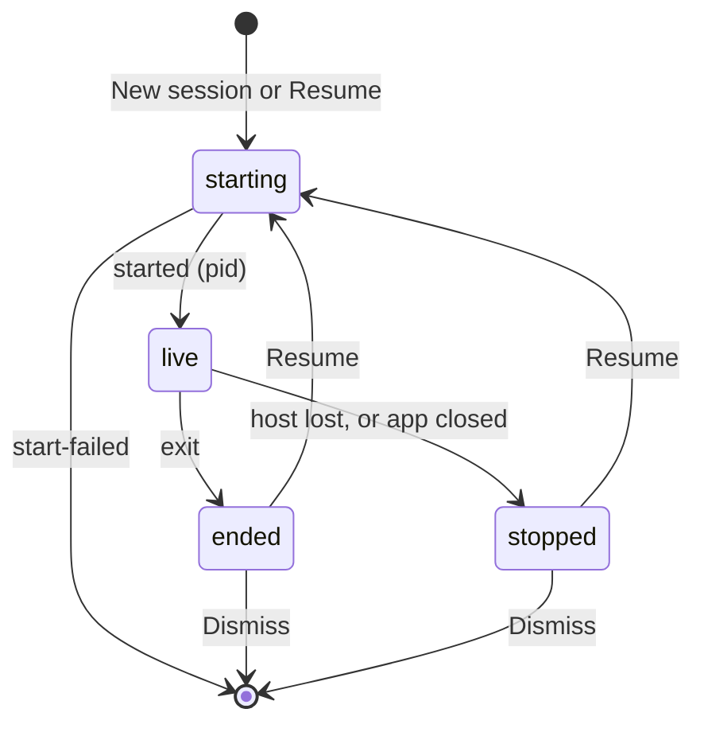

# Hosted sessions

## What it is

A hosted session is an interactive `claude` that the app starts in the terminal host. The server keeps a record of each one, shows it on the Board as `repo.hosted`, and has three routes: New session, Resume, and Dismiss. It also serves a session's saved screen. The terminal side is in [terminal-host.md](terminal-host.md).

## How it works

- **Channel** (`terminal-channel.ts`): only a server that main started has one (a real `parentPort` and `OPENAFLOW_TERMINALS=1`). Dev and `pnpm start` have none, so New session answers `409 no terminal host`.
- **Store** (`session-store.ts`, `<config>/sessions.json`): written whole, by temp file and rename. Per record: repo, marker, pid, state, stop command, scrollback, times. No typed text.
- **Reconcile** at each start: asks the host to `list`. Listed and live stays `live`; listed and ended becomes `ended`; unlisted becomes `stopped · app closed`. Records that changed during the wait keep their state.
- **Plugins** (sprint default-workflow §6): every session loads the hooks plugin with `--plugin-dir`. A repo with `.openaflow/` (`model.openaflow`) also gets `--add-dir <workflow> --disallowedTools "Edit(//<workflow>/**)" --plugin-dir <workflow>` (`workflow-flags.ts`), right after the hooks plugin; a prompt stays last. The `--add-dir` lets claude read the workflow's own files (pod skills read `${CLAUDE_PLUGIN_ROOT}/…` early) with no "Do you want to proceed?" prompt. The one resolver (`workflow-resolver.ts`, from `OPENAFLOW_WORKFLOWS_DIR`) picks it. A repo without `.openaflow/` starts with the hooks plugin only, so an installed claude-pod writes `pod-docs/`.
- **Routes**: `new-session`, `resume-session`, `dismiss-session`. First-match errors: `400 bad request`, `409 no terminal host`, `404`, `409 claude not found`, `409 workflow missing` (set-up repos only: no bundle, or only unknown sources), `409 run wrapper: …`, `409 session starting`, `409 too many sessions` (10 live or starting). Dismiss refuses a live session. Resume re-checks everything.
- **Board**: `HostedSession` joins the hook file (`hooked`, `prompted`, `liveSession`) and carries no pid and no text. `Board.workflow` is the bundle's source and version. An `ended` session with no hook line and no prompt gets `blocked: 'sideload'` when Claude Code's managed settings file (`managed-settings.ts`) sets `disableSideloadFlags: true`. The Board reads that file at most once per build, and only when such a session exists. A session joins a run only when an agent of that run holds one of its IDs.
- **Screen** (`screen-route.ts`): `GET /api/sessions/<marker>/screen` with the token answers the saved text.

**Worked example.** New session with Plan and "add tags" saves `starting`. `started` makes it `live`. You kill the app. At the next start the reconcile finds it unlisted and writes `stopped · app closed`. The tab shows the faded saved screen with Resume. Resume starts `claude --resume <id>` as a new record; once it has started, the old record, hook file, and screen are deleted.

## Why it's this way

- **A real `parentPort` turns the channel on:** every `OPENAFLOW_*` reaches a resumed `claude -p`, so the env alone would turn it on in a process main never answers.
- **No typed text in the store, log, or Board:** only the start itself carries it.
- **Screens on disk, owner-only:** a Resume or restart needs something to show. Never on the Board or in a log; read with the token. Turned down: keeping no screen.
- **The record keeps its stop command** ([settings.md](settings.md)): a sweep after a crash must use the stop its start used. Turned down: the current setting.
- **A timeout keeps the record `starting`** ([decision](../decisions.md#2026-11-19--a-start-or-resume-that-times-out-keeps-the-record-starting-agent-default--override-anytime)). Turned down: dropping it.
- **A repo without `.openaflow/` starts as before** ([decision](../decisions.md#2026-11-24--a-repo-without-openaflow-starts-hosted-sessions-as-today-human)): blocking it until setup would take hosted sessions away from every `pod-docs/` repo. Turned down: block both until setup; block new sessions but allow Resume.
- **The managed settings file, not claude's printed text, marks a sideload block:** the text can change in any release.
- **Join a run only by session ID** ([decision](../decisions.md#2026-11-19--a-hosted-session-joins-a-run-only-through-an-agents-session-id-agent-default--override-anytime)). Turned down: the first transcript mention.

## Watch out

- A `504` leaves the record `starting`, so that repo answers `409 session starting` until a late answer or the next start.
- A late `started` after a Resume's 504 leaves the old record too. Dismiss it by hand.
- Remove repo while a session is live leaves it running with no row, and it still counts toward the 10 ([decision](../decisions.md#2026-11-19--remove-repo-while-a-session-is-live-agent-default--override-anytime)).
- `stopped · app closed` has no end time.
- The scope probe's first run can take about 6 s; the first New session waits for it.
- Records from before the settings sprint have no `stop`; the sweep sends none for them.
- Tests start sessions only with a fake `claude` behind `OPENAFLOW_CLAUDE_BIN`.
- Resume reads the repo as it is now: a session started before setup resumes with the workflow plugin.
- The settings preview shows the workflow folder whenever there is a bundle, even though a repo without `.openaflow/` doesn't load it.
- `claude --help` lists `--add-dir <directories...>`, so it takes every word up to the next flag. It stays right before the workflow's `--plugin-dir`. Put last, before the prompt, it would likely read the prompt as a second folder (not run with real `claude`).
- The workflow's `Edit(//<workflow>/**)` deny rule (Windows: `//c/...`) is checked against the Claude Code permission docs only; no real `claude` run has shown that it blocks an edit in an `--add-dir` folder under `acceptEdits`, and a wrong form would block nothing. Bash file commands are not covered.
- A session that starts through cmd.exe (a `.cmd` shim the app can't read, such as pnpm's) gets its deny rule from a settings file, `<config folder>\workflow-deny\<16 hex>.json`, passed with `--settings`, not as `--disallowedTools`: node-pty quotes only an arg with a space, and a shim that runs `%*` inside a `( )` block would end the block at the rule's `)`. The file is written at each start; if it can't be, the start fails as `400 settings not written` (the page shows the try-again text).
- `blocked: 'sideload'` is only a guess from the file: any ended session that never hooked counts, whatever ended it.

## History

- 2026-11-27 · task pre-v010-fixes fix pass · fixed: a New session or Resume that starts through cmd.exe also gets the workflow's Edit deny rule, from a settings file in the config folder passed with `--settings`; it had `--add-dir` with no rule.
- 2026-11-27 · task pre-v010-fixes · added: an `Edit(//<workflow>/**)` deny rule (`--disallowedTools`) after the workflow's `--add-dir`, from one builder (`workflow-flags.ts`) for New session, Resume, Continue, and the settings preview, so a session can't change the bundled workflow's files. Not on the cmd.exe start path. The preview quotes words with `( ) * ? [ ]`.
- 2026-11-24 · task add-dir-workflow · fixed: a set-up repo's session stalled on a read prompt for the bundled workflow's own files. New session, Resume, and the settings preview now add `--add-dir <workflow>` before the workflow's `--plugin-dir`. Proved with real `claude` in `real-workflow-start.test.ts`.
- 2026-11-24 · default-workflow · plan complete: the bundled workflow in hosted sessions and the sideload stop line; final PR [#166](https://github.com/alvionlabs/openaflow/pull/166), review round 1 `fix` (5 findings, fixed in #167), round 2 pending · [report](../reports/default-workflow.html)
- 2026-11-24 · default-workflow plan fix · fixed: the Terminal tab's Resume shows "The app doesn't have this repo's workflow. Please reinstall it" for `409 workflow missing`, as New session does; it showed the try-again text, and a retry never worked.
- 2026-11-24 · default-workflow S3 · added: a second `--plugin-dir` with the bundled workflow for repos with `.openaflow/`, `409 workflow missing`, `Board.workflow`, `blocked: 'sideload'` from the managed settings file, and the workflow folder in the settings preview. Repos without `.openaflow/` start as before.
- 2026-11-19 · plan terminal-host complete · rewrote this page to the current state · [report](../reports/terminal-host.html), [PR #155](https://github.com/alvionlabs/openaflow/pull/155)
- 2026-11-15 · settings S4 · changed: the start takes its run wrapper and stop command from `settings.json`, with a wrapper check for a changed wrapper and `409 run wrapper: …` / `409 stop command: …` refusals; the record keeps `scrollback` and `stop`, and the sweep sends each record's own `stop`.
- 2026-11-15 · session-life S3 · added: the Resume route, the `resume` check on the Board, saved screens and their route, the Linux run wrapper on New session and Resume, `sweep` after the reconcile, `labels` after each Board change, and `resume-session` log entries.
- 2026-11-15 · terminal-tab S1 · added: the session store, the terminal channel, the reconcile, the New session and Dismiss routes, `hosted` on the Board, the watch on hook files, and the two action log kinds.
