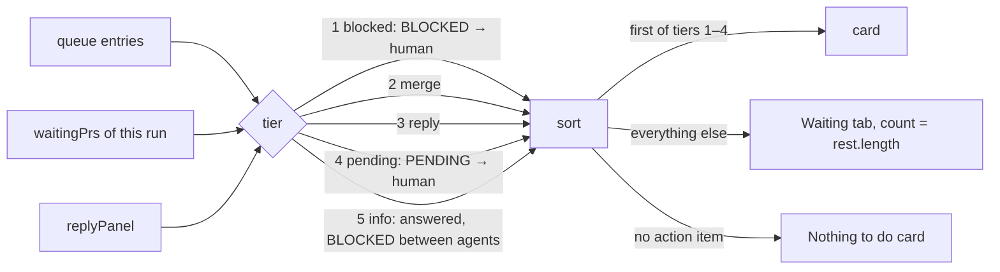

# Runs list and pipeline

## What it is

Screen 1: a full-height left sidebar (the title, the runs list, and `Add repo`, which opens a path field in the shared modal, with `Browse…` beside it in the desktop app) and a main column with the selected run's header and ⋯ menu, the run's **flow**, its **Next step** card, and the Waiting and Log tabs. Covers the features.md rows Screen 1 (all five), Waiting tab, Other activity, Unsupported docs and no runs, and the page side of Merge, Reply panel, Autopilot run, and Continue and auto-continue. Run rules are pure in `packages/model/src`; screen 1's views are pure in `packages/web/src/screens/runs` (`next-step`, `plan-view` (the flow's columns and the header), `tab-memory`, `menu-view`, `waiting-tab`, `add-repo-flow`, `remove-flow`, `forget-flow`); components are glue.

## How it works

- **Which runs:** each plan not archived or finished, plus each plan, `task-<slug>` or `fix-<slug>` a claim file names. A `task-<slug>` or `fix-<slug>` claim that names no plan is a one-off run (`fixRuns`, the "fix run" in this file): pod 0.10.0+ starts it with `/pod:task` (claim and branch `task-<slug>`, reviewer `kind: task`), and older pod with `/pod:fix` (`fix-<slug>`, `kind: fix`). Both kinds read the same way; only the tag and the header word differ (`oneOffKind`, `runTag`). A reviewer of either kind joins the run its branch or PR names. A merged task PR gives the same `fix-merged` reply as a fix PR, so auto-continue and the tray treat both kinds the same, and stored toggle keys stay valid. A claimed archived plan stays while its hand-back entry is pending, while halted, or while an agent of it wrote in the last 30 minutes. A fix run stays while its claim exists, however long ago its PR merged, with or without a merge time from `gh` ([decision](../decisions.md#2026-11-05--a-merged-fix-run-stays-listed-until-cleanup-human-decision)). Cleanup freeing the claim is what ends it. Agents join a plan by its `plan` field, a sprint, or their role ([run-model.md](run-model.md)).
- **State,** first match: `blocked` → `needs-you` (`holdsRun`, or a PR in `waitingPrs`) → `running` → `idle`. **What stops a run** (`stopsRun`, one rule that the state, flow, Log, wave board, Next step and banner all read): a BLOCKED to you, a halt gate from the orchestrator (`haltGate`, gate 7 included), a plan-complete hand-back (from the orchestrator, with the plan's own slug or none, or the hand-back `handBackPr` reads: `final PR`, `final merge`, `hand-back`, with a PR link), an `ask:` entry to you on a plan, from anyone, also with a recorded default, the orchestrator's plain ask to you on a plan (its words ask, `ASKS`: `needs your …`, `needs you`, `waits on you`, `waiting on you`, `your go`, `call`, `answer`, `decision`, `input`, `approval`, `review` or `ok`, a sentence that starts with `please`, `can you`, `could you`, `pick`, `choose`, `decide`, `confirm` or `approve`, or it ends in `?`; no kind word, `fix next:` included among those, and no recorded default), or a PENDING to you that names an open slice and records no default (`Value in use:`, `Default:`, `Default recorded:`, or `agent default`). A default, `someday`, a bare `now`, and any other note from a reviewer or an engineer don't stop it or change its state: they stay in the Waiting tab, counted and answerable. A BLOCKED between agents is pod's to resolve, and reads `No answer needed`. **What runs a wave** (`isSliceRunning`, `isWaveRunning`; the state, flow, Log, wave board and replies all read them): an unfinished slice that pod holds (`pushed`, and an agent of the plan wrote within `ENGINEER_QUIET_MS`, ended or not; on a manual run, not once gh says its PR merged, since it then waits for your `continue`), or its own engineer or its wave's fix engineer at work, meaning not ended and written within `ENGINEER_QUIET_MS` (1 h). That is longer than `isRunning`'s `STALE_MS` (30 min), so a long quiet step doesn't read as stopped, and bounded, so a closed laptop stops reading as running. Other agents keep `isRunning`. **A stop reads first** (`holdsRun`, `isPlanHeld`): a BLOCKED always holds the run, whatever runs there. A PENDING gate, hand-back, `ask:` or plain ask holds it only while no engineer is at work: `PENDING` only needs acknowledging, so a resumed autopilot goes on past it. Then all views read running, and the gate stays listed and answerable, with its own words as the title and `An engineer is at work on this run. Answer when you can.`. An engineer quiet up to `ENGINEER_QUIET_MS` counts as at work, so a plain gate 5 or 6 reads running until 1 h after that engineer's last write, then `needs-you`. **Replies follow:** while the run reads `running` on a wave (`waitsOnWave`), `planReplies` offers nothing, so neither the card nor `autoSends` sends a `continue` into a working session. Under autopilot this holds while pod holds a pushed slice, whatever the run reads (`autopilotHoldsPushed`), also once you answered a plain ask that made it `needs-you`. A BLOCKED halt, or a gate naming that slice's PR, is the exception: pod ended its turn, so `continue` is how it resumes. A stale gate pod resumed past names no later wave's PR, so the guard applies; a real gate that names no PR waits for the window too. A dead engineer, or pod dead on a pushed slice, holds `continue` back until 1 h after the last write; then the run reads `idle`. On a stopped run it doesn't wait past `isRunning`'s 30 min. The session stays open to a `continue` you type yourself. Pipeline steps: `blocked` → `done` → `you` → `live` → `wait`; the flow adds `unknown` (not recorded) and `skipped` (the plan didn't take the step).
- **Autopilot runs** (a `<!-- autopilot-run` line in the active sprint doc): their wave PRs read `PR #N · autopilot merges` and aren't in `waitingPrs` until autopilot stops for you (a `BLOCKED`, or a `PENDING` starting with its gate), then `PR #N · autopilot stopped` with Merge. No Go step.
- **Fix run merge** (`fixWaitingPr`, one rule for the row, the flow, `waitingPrs`, and the replies): an open PR waits on you in two cases. First, it is reviewed: the agent that wrote last is a reviewer that ended. Second, it is a no-review PR: gh found it by branch with `skipped (--no-review)` in its body (`reviewSkipped`; pod's PR template writes that text for `/pod:task --no-review`), no reviewer joined the run, and the run's newest engineer turn, by start, ended. Then the run reads `PR · needs-you`, Ship reads `PR #N · you merge` with Merge, and Round 1 reads `skipped · --no-review` (dim). A merged no-review PR also keeps Round 1 `skipped`, with or without a transcript. Until then, or with no flag, the PR reads `review · idle` and Ship `PR #N · after review`. A reviewer that joins brings back the reviewed rule. gh's `body` is read only for PRs found by branch and is reduced to that flag at parse: the text never reaches the Board or a log. Every PR read also gives `openedAt`, from gh's `createdAt`.
- **Times:** active minutes only; gaps over 15 minutes (30 when they end in the awaited tool result) don't count.
- **Next step** (`nextSteps`): every item that waits on you, sorted by tier, list order kept within a tier (in `pending`, stops first, then by kind). The first item of an action tier is the card; the rest go to the Waiting tab. A pending entry that doesn't stop the run (`goesOn`) can be the card, and wears the run's own status (`runStatus`: `Running`, `Needs you`, `Blocked`, else `Idle`), with `pod goes on with the value in use until you answer.`; a stopping PENDING says `The run is stopped until you answer.` A plan's own BLOCKED says what `planState` says: `Blocked` on a halt, else `Needs you`, in the `blocked` tier either way. An entry with no plan stays listed in the Waiting tab on a plan or fix run, and never takes its card, however real it is. A repo row has nowhere else to show one, so it keeps a BLOCKED to you, a halt gate or a hand-back as its card.

  Example (chess-web `sparring-ladder`, autopilot halted at gate 3, wave 3 PR #78 pushed): the `BLOCKED · orchestrator → human` halt is the card with Answer and "The run is stopped until you answer."; `rest` starts with `Merge PR #78` ("Wave 3 of ladder is handed back to you."), then the fixture's other entries. With a gate 6 `PENDING` halt instead, `Merge PR #78` is the card and the halt waits in the tab.
- **Card:** label, status dot and word, title, detail, one action. An entry that starts with an autopilot gate (`haltGate`, the model's `PENDING_GATE` rule) gets a plain title (`gateTitle`): gate 1 `Autopilot stopped: a slice is blocked`, 2 `…the final review still fails`, 3 `…<wave/final> PR #N couldn't merge` (the word left out when the entry says neither), 4 `…the wave check failed`, 5 `…it hit a safety limit`, 6 `Autopilot held PR #N for you to merge`, 7 `Plan complete: review and merge the staging PR`; a pull URL in the entry makes `PR #N` a link. Gates 3 and 6 with no PR, and any other entry, keep the cut entry text. The full text stays in the Waiting tab and shows above the box when the card's Answer is open. Answer and Merge open in place under the card with the card's own flow; a reply shows its rows (`ReplyPanel framed={false}`). `Nothing to do` is the dashed `.card.calm` with no button; its detail is `run.where`, or `emptyMessage` for an error, unsupported or plan-less row.
- **Urgent banner** (`elsewhere` in `screens/runs/elsewhere.ts`, then `UrgentBanner`): one line at the top of screen 1 for an item in another run that is more urgent than the selected run's card. It reads only each run's card (`nextSteps(run, repo, now).card`, never `rest`) and ranks it by tier: `blocked` 4, `merge` 3, `reply` 2, `pending` 1, `nothing` 0. Another run's card can raise a banner when it is `blocked`, `merge` or `reply`, or a `pending` entry that stops its run (`stopsRun`), of any kind; a pending entry pod goes on without, a plan-less gate, `nothing`, and answered entries (`info`) never do. A plan-less BLOCKED raises one only from a repo row's card. It must rank strictly higher than the selected card; a selected entry pod goes on without ranks 0, like `nothing`. Ties: in `blocked` and `pending`, the oldest entry date wins (an undated entry after every dated one), then the earlier run in the sidebar; in `merge` and `reply`, the earlier run in the sidebar. `+N more` counts the other outranking items, each once. The selected run is matched by `hashFor`, so it is never a candidate; a run whose repo isn't on the Board is skipped. The banner shows the status dot and word, the item's title (a title link is plain text), `· <repo> · <run name>` muted (the run name alone for a plan-less row; the repo hides at 480 px and below), `+N more`, and `Open run` (`btn sm trail` with `arrow-right`, named `Open run <name>`, linking to the run's pipeline). It has no action, no close button and no animation, and it holds no state: each Board recomputes it, so it appears, swaps or goes away on the next render. Placement: the first child of `main` on the pipeline and agent views, before the error `.banners`; never on the wave board or the engineer view. Accessibility: a `role="status"` region (`.urgent-slot`) is in `main` whenever a run is selected there, empty and 0 px tall when nothing outranks, so a new item is announced once and an unchanged one isn't re-announced. After `Open run`, focus moves to the new run's title (`h1.run-name`, `tabIndex={-1}`). Styles in `urgent-banner.css`: `--border-strong` border, `--bg` fill, 8 px radius, 8 px by 16 px padding (8 px on the button side), one line with the title ending in an ellipsis; at 480 px and below the text wraps and `Open run` is full width and 44 px tall.
- **Header** (`runHeader`): a plain title and one muted meta line under it, as on a CI run page; no crumb, slash or eyebrow. The title is the run's human name: a plan's title (`# Plan:` line); a fix run's PR title without its conventional-commit prefix (a known type, an optional scope and `!`, then `:`; the rest kept as written, so `iOS` and `gh` keep their case), else its slug made readable (`sprint-column` → `Sprint column`); a plan-less row's repo. The meta line is `<repo> · <Plan|Task|Fix> · started <N min / N h / N days ago>` (`startedAgo`), each unknown part left out. `started` (`startedText`): for a plan, the earliest of these candidates: the plan doc's `<!-- autopilot-run: started=… -->` stamp (`autopilotStartedAt`, if any) and every read agent's start (`isPlanAgent`); with no stamp and no agent clearly inside the transcript window (none at all, or the earliest near or past its edge, so older agents may be unread), the `Generated:` day too. A time more than a day inside the window (the Board's `transcriptDays`, `OPENAFLOW_TRANSCRIPT_DAYS`, 30 when missing) reads `N ago`; any other reads as a date (`started Sep 20`: a time's local day, the `Generated:` day as written). A date names the year when it isn't this year (`started Oct 12, 2025`). With no candidate, nothing. A fix run: its earliest agent (`fixRunAgents`), else nothing. The same name (`runName`) heads the run's sidebar card. A plan-less row has no meta line. The PR title comes from gh's `pr list --head` (`title`, on PRs found by branch only). On the right `Open the wave board` (a quiet small button, `Wave board` at 480 px and below; plan runs only, not on the wave board view) and the ⋯ menu, then a strip with one segment per flow step (done, current, rest) and `Wave N of M`. An `unknown` or `skipped` step counts as done once a later step started. A fix run and a plan-less row have no strip.
- **Flow** (`buildFlow` in `packages/model/src/flow-steps.ts`, then `flowColumns` and `Flow`): Think → You → Sprint → Check → Ship, a column with no steps left out. The Sprint column (`sprintColumn`) stacks every sprint in plan order, the steps `buildPipeline` reads for each: a done sprint folds to one card (its name, `N waves`), the current sprint shows one card per wave, a later sprint is one waiting card with its name. Its caption is `Sprint N of M`, N the plan's current sprint, or M when none is current (all done, or the plan archived). So the flow always has five columns, however many sprints the plan has, and the Sprint column can be the tallest. Layout: one grid (`.flow`), a heading row, then row i holds every column's i-th card; columns and their step lists are subgrids, so the cards of a row share one height. Cards sit 32 px apart both ways (the heading 16 px above its first card). Each card reserves its title and two detail lines (`min-height`); a longer detail wraps in full and its whole row grows. Connectors (`flowEdges`, drawn by `Flow` in an `aria-hidden` SVG over the grid): one main path through every step but Fix pass, in the order things happen (a fix run's Engineer → Round 1 → Round 2 → PR), down inside a column (`downPath`, bottom-middle to top-middle) and across from a column's last card to the next column's first (`stepPath`: an orthogonal smooth-step route, out of the right edge at its mid-line, one turn in the middle of the column gap, vertical, a second turn, into the left edge at its mid-line, with 6 px rounded corners; a straight line when both share a mid-line), each with a small chevron head (`headPath`) pointing straight into the target edge; these live in `screens/board/geometry.ts` beside the wave board's `edgePath`. Lines are `--border-strong`; the path up to and into the current step (the first blocked, needs-you or running step, else the first waiting one; all of it when none) is `--fg`; Fix pass (`fix`, `fix-pass`) is a dashed detour off the review step it follows (Final review, or a fix run's Round 1, drawn back to the Build column with `backPath`, the same step route through the gap, from two thirds down Round 1's left edge to a third down Fix pass's right edge) and on to the next main step; the detour is walked only once the fix pass ran, and while it runs the main path stops at its review step, so the walked line never passes a step that didn't run. Card positions are measured from the page against `.flow` and redrawn on resize, on a data change, and once fonts load; a folded flow (nothing laid out) is skipped and drawn when it opens. A fix run shows `buildFixPipeline`'s Build, Review and Ship. Each card: an SVG mark (`check` done, `dot` running (it breathes: opacity eases between 1 and 0.45 over 2 s, base.css's `breathe` keyframes, also on the phone's fold line and every running status dot; solid under reduced motion), `alert` needs you, `blocked` blocked, `circle` waiting, unknown or skipped) in its status colour, the step's label, its state word for screen readers, and its detail in muted mono. Running, needs-you and blocked cards (`hi`) get a border in their status colour; waiting, unknown and skipped ones (`dim`) take muted text and a faint mark. No Merge button: the Next step card (or the Waiting tab) holds it. A plan-less row has no flow.
- **The step registry** (`FLOW_STEPS`): every step but the waves is one entry, `{ id, column, label, read }`, where `read(ctx)` takes the repo, the plan, the time and the plan's pipeline and returns `{ state, detail }`, or nothing to leave the step out. The waves come from the sprint docs, as `buildPipeline` reads them. **To add a step,** add one entry in its column (in the order it shows) with its reader, and a test in `flow-steps.test.ts` for each state it can read; nothing else changes (the strip, the fold line and the cards all read the flow). **To remove one,** delete its entry and its test. A reader marks a step `done` only on data that proves it; with nothing to read it returns `unknown` with "not recorded". The readers:

  | Step | Column | Reads | States |
  |------|--------|-------|--------|
  | Research | Think | `pod-docs/research/<plan>.md`, or a `research/<slug>.md` the plan doc links that exists; `pod:researcher` agents with this plan | done `report` or `N researchers · M min`; running while a researcher runs with no report; `not recorded` for a link to a missing report; else skipped `no research` |
  | Plan interview | Think | the plan doc's `Grilled-with:` | done `grilled with <value>`; else `not recorded` (pod records no question count) |
  | Look picked | You | the plan's `## Look` | done with its `direction X`, else `look set`; skipped `no UI` with no Look or one that says none or no UI; `not recorded` when the section is empty |
  | Replied go | You | the pipeline's Go step | `not recorded yet`; left out on an autopilot run |
  | Final review, Fix pass | Check | the pipeline | as before |
  | Final PR | Ship | the pipeline | as before |
  | Staging → main | Ship | the final PR's base, else the `merge target: staging` decision in `pod-docs/decisions.md` (its backticked branch, else `pod-staging`); the staging branch's PR by head | left out with no staging branch; waits `after the final PR`; then an open staging PR always counts, `PR #N · you merge` (needs you), even one pod reused from an earlier plan; a merged one is `merged PR #N` only when gh's `mergedAt` is after the final PR's; else (merged earlier or with no times, closed, or none) `not open yet` |

- **Fold on phones:** at 480 px and below the flow starts folded to one button (`aria-expanded`) naming the current step with its mark (`foldLine`: the first blocked, needs-you or running step, else the first waiting one, else the last; `<label> · <detail>`). Pressing it opens the full flow, which scrolls in its own box; pressing again folds it. Nothing is remembered: every load and every run starts folded. Desktop always shows the full flow.
- **Tabs:** Waiting and Log. One open tab per browser in `localStorage` `openaflow-tab`; nothing stored, or a `plan` stored before the Plan tab went away, means all closed. On `/agent/<id>` the Log tab shows open without saving.
  - **Waiting:** pending entries group by kind: `Asks` (`ask:`) first, then Now, Decisions, Before a step, Other, Someday. Route and date, body clamped to two lines until clicked; Answer only on entries routed `→ human`, with `answerNote`; Merge on a PR row; the reply rows.
  - **Log:** a wave's status reads `PR #N open` (amber) only while that PR waits on you (`waveWaitingPr`); one autopilot is merging reads as the wave does (`running`). The slice log (a fix run: its agent log and engineer view), Other activity (the repo's agents in no run, last 2 h, newest 8), and the Action log (newest 20).
- **Reply rows:** each word, its why, Copy, and Continue or Go when sendable. The session line, the no-session note, `cd` and `claude --resume` sit behind `Run it yourself`.
- **No runs:** with no repos, "No repos yet" says to press `Add repo`, and names pod with its install step (`POD_INSTALL`). A repo with no pod docs version gets the same step in its card, because the model can't tell no pod from an older pod. The setup check doesn't look for pod.
- **Sidebar:** "OpenAFlow", with `lost · retrying` beside it only while the stream is lost (health checked every 5 s, 4 s limit); `Runs` (no count: the cards show each state); the runs, one short card each (the run header's own name (`runName` through `runCard`); under it the repo, muted, and the `task` tag for a /pod:task run or the `fix` tag for an older /pod:fix run, so the tag shows once; a plan-less row's name is the repo, with no second line; the status dot and word top right, on the name's line), 12 px apart, with the selected one on the hover background with the strong border; `Add repo` a regular 40 px button as wide as the cards, icon and label centred; `Add repo` at the bottom. The ⋯ menu, in the run header (or beside "No repos yet"), holds Auto-continue for the selected run, System / Dark / Light, and `Ports <n>` for a claimed run; Escape or an outside press closes it and returns focus. `Add repo` opens the shared modal first, with focus in an empty path field, in the desktop app and in the browser build; no folder dialog opens by itself. In the desktop app, `Browse…` (a regular button with the folder icon) sits at the right of the path field, on its row; the field takes the rest of the row, and fills it in the browser build, which has no `Browse…`. `Browse…` opens the system folder dialog (`folderBridge`); a picked folder fills the field, clears any error, and posts nothing, and focus moves to Add, so Enter adds it. Cancel in the folder dialog leaves the modal as it was and puts focus back on `Browse…`. After a refused Add, focus goes to the field. While the dialog is up the modal is busy: Add, `Browse…`, Cancel, and Escape do nothing. A path error (the first two messages below) shows directly under that row as `--danger` text at 14 px with the `--blocked` alert icon (`.modal-field-error`), with the field marked invalid; any other error shows in the shared alert box (`ModalAlert`: a `--blocked` border, a 12% `--blocked` tint on the panel, the alert icon, the text in `--fg` at 14 px) above Cancel and Add, which Remove repo and Forget also use. The label, the row, and a path error sit 8 px apart; the heading, that group, and the alert box 16 px apart; Cancel and Add 24 px below the last (runs.css, scoped to `.add-repo-modal`). The modal says one of four things (`addError` in `add-repo.ts`): "This repo is already added." (`409 already registered`), "This path isn't a folder on this computer." (`400 not absolute`, `not a local path`, `not a directory`), "The app restarted. Reload the page." (a dead or missing token), or "Couldn't add the repo. Try again." for anything else, with the exact cause in `console.warn`; a folder dialog that can't open shows "Couldn't open the folder dialog. Type the path instead." in the alert box, keeps the modal, and puts focus in the field. In both builds, Add stays off while it's blank, and after a path error (the first two messages) until the path changes; after any other message Add stays on, so the same path can be tried again; Escape, Cancel or a backdrop click closes the modal. Add posts to `POST /api/repos`, and a `201` closes the modal and returns focus to `Add repo` (`add-repo-flow.ts`).
- **Run order** (`listRuns`, `runActivity` in `packages/model/src/runs.ts`): newest first, by each run's last activity, read from the Board's data only. It is the newest of the run's agents' `lastAt` (`isPlanAgent` for a plan, `fixRunAgents` for a one-off run), the `date` of each queue entry tagged with the plan (read as `<date>T00:00:00Z`; a one-off run has none), and the `openedAt` and `mergedAt` of its PRs (a plan's slice PRs in all its sprints, its hand-back PR, and the PR on branch `<plan-slug>`; a one-off run's PR by its branch). An error, `update pod`, or `no active plan` row has none, and a row with none comes last. Ties go to repo name, then plan slug. State doesn't order the list, and `now` never does, so one Board gives one order: a newer idle run sits above an older blocked one, and the card's status word is the only urgency cue in the sidebar. The page picks its run by hash, so a run that moves in the list stays selected. The urgent banner's last tie (the earlier run in the sidebar) follows this order.
- **Layout:** a full-height sidebar with a right border, 260 px until you resize it: a handle on its right edge (`SideHandle`, `role="separator"`, `aria-orientation="vertical"`, `aria-valuenow`/`min`/`max`, focusable) drags it from 200 to 400 px (`sidebar-width.ts`), with pointer capture and no text selection while dragging (`data-resizing` on `<html>`); Left and Right step 16 px, Home and a double-click reset to 260; the width is kept per browser in `localStorage` `openaflow-sidebar-width` and read clamped (junk reads 260); the handle shows a 2 px `--focus` line on hover, focus and drag, a focus ring, and `col-resize`, and is gone at 820 px and below. Then one shared main column, 1120 px at most (five flow columns), centred in the space beside the sidebar; the header, strip, flow, Next step card and tabs all span it, so their edges line up. The flow's columns grow from 208 px to fill it (a fix run's three get wide) and shrink to 152 px, below which they scroll sideways in their own box (`.flow-scroll`), with the fold line outside it. Text inside the card, the Waiting rows and the answer entry stops near 72 characters (`72ch`); the Log tab's tables span the column; the wave board (`/board`) takes the full width with the header and `Back to the run`. At 820 px and below the sidebar stacks on top. At 480 px and below `Runs` hides, the flow folds to one line, and the header and flow gaps tighten (12 px, 16 px), so on a two-run board with no urgent banner showing, the Next step card and its button fit a 375 × 667 screen (measured: 662 px with the plan's title on two lines and a three-line card title, after the strip, the card's heading and its button moved in to 8, 8 and 16 px; 629 px with the gate 3 halt and the short `Wave board` link, which keeps the plan name on one line).

## Why it's this way

- **One next step, the rest behind closed tabs** ([plan](../plans/calm-dashboard.md#key-decisions)): the old screen showed every control at once. calm-dashboard turned down a card across all runs; plan next-step-across-runs reversed that as a banner, not a card ([decision](../decisions.md#2026-11-01--urgent-items-from-other-runs-show-as-a-banner-reverses-calm-dashboard)): the sidebar dots show state, but not which other run needs you more than this one. The banner only navigates, so the selected run's card keeps the page's one primary button.
- **The card picks only from the model's rules**, so it can't disagree with the wave board or the merge routes. Wording and the halt-versus-PR order are agent defaults ([wording](../decisions.md#2026-10-28--next-step-card-wording-agent-default--override-anytime), [halt](../decisions.md#2026-10-28--an-autopilot-halt-and-a-waiting-pr-on-the-next-step-card-agent-default--override-anytime)).
- **The Windows folder dialog, or a path field** (ui-rework, draft pick 8 b): the desktop app opens the Windows Select Folder dialog through its bridge. The browser build is a test bench for agents, which can type a path, so it gets a plain path field. Our own folder browser and its `/api/fs/folders` route are gone: the human asked to stop maintaining them. Before, no browser picker returned a full path ([research](../research/folder-picker.md)).
- **Controls open in place, never a modal; no red on Merge** (plan Looks): the confirm step carries the weight. The exceptions use the shared modal: `Add repo` (fix-sidebar-add-dialog, then ui-rework pick 8 b), and `Remove repo` and `Forget this run` (ui-rework picks 6 c and 7 b), which replaced the in-place Remove panel.
- **A full-height sidebar, not a top bar:** the human asked for the layout from before plan calm-dashboard back, keeping the calm-dashboard look.
- **A claimed plan stays a run through close-out:** pod archives the plan before the final merge and waits for `continue`. Turned down: ending it at the merge (review round 1 of #33).
- **Autopilot's wave PRs aren't yours** until it stops ([decision](../decisions.md#2026-10-26--autopilot-runs-show-their-wave-prs-as-autopilots-agent-default--override-anytime)); **times skip idle gaps** ([decision](../decisions.md#2026-10-26--slice-times-skip-idle-gaps-over-15-minutes-agent-default--override-anytime)); **only listed runs show their entries** ([decision](../decisions.md#2026-10-22--only-listed-runs-show-their-queue-entries-agent-default--override-anytime)).

## Watch out

- **A leftover fix run stays until someone frees its claim.** If a session crashed or never ran cleanup, its run stays listed, with its card and Continue, and the tray dot stays on, until its claim file goes. `Remove repo` doesn't help: it only edits `config.json`, and a claim file adds the repo back. A claimed run keeps Continue while its session is inside the 30-day transcript window ([server.md](server.md)). Past that window, a merged fix run with no agent on the Board stays listed, its Engineer and Round 1 read `done` with `no transcript`, and it offers Copy with no Continue. Press Continue if the session can still run. Otherwise use `Forget this run` in the run's ⋯ menu (only when `forgetCheck` allows it): its modal shows three mono lines, the worktree path (a plan run: the `.claude\worktrees` folder), `run <name>` (the claim's run name), and `port base <N>`, which is what an undo needs. The app can't undo it: write `<ports dir>\<port base>` again with `<repo path> <run name>`.
- Key `NextStepCard`, `WaitingTab` and `BarMenu` by the run, and keep the card's reply slot mounted for any run with a plan: otherwise a Continue result vanishes when the Board drops the reply. It shows on the next card until Close.
- After Answer saved from the card, the card moves on, so focus lands on `body`.
- An answer doesn't clear a stop: the row reads answered, and the run `needs-you`, until pod resolves the entry. An answer to an entry that never stopped the run changes no state.
- The flow's Go card reads `unknown · not recorded yet`, dim, even after later steps start (queue, someday).
- The flow's Sprint stage is keyed `sprint` (steps `sprint:<slug>` and `sprint:<slug>/wave-N` after `flowColumns`), while `buildPipeline` keeps one `sprint:<slug>` stage per sprint for the wave board and the Log tab. Look a step up by the flow's keys when testing the flow.
- Each `.flow-step` keeps `position: relative`: it holds its `.sr-only` word. Measure the connectors against `.flow`, not `.flow-scroll` (4 px padding given back by a -4 px margin, and only the visible width on phones).
- The flow's scroll box (`.flow-scroll`) is the positioned parent of the cards' `.sr-only` words; without `position: relative` they escape it and widen the page (828 px at 375 px).
- `Flow` and `NextStepCard` are siblings: key them differently (`flow:<run>` and `<run>`). A shared key left the last run's flow on screen after a run switch.
- `pod-staging` is reused by every plan, and pod's gate 7 reuses an open `pod-staging` → `main` PR, so its number can be below the final PR's: never compare numbers. An open one counts; a merged one counts only when it merged after the final PR (`mergedAt`). gh re-asks the staging branch even after a merge (`refresh(…, staging)`).
- The chess-web fixture's `## Look` sections are empty (scrubbed), so Look picked reads `not recorded` there.
- Two repos with the same folder name show as two identical rows (queue, someday). Their cards now differ by run name, but the muted repo line still reads the same.
- The resize handle sits in the sidebar's grid cell as a sibling of `.side`, not inside it: `.side` scrolls (`overflow-y: auto`), which would clip the handle's overhang and its focus ring. `.side`, `.side-handle` and `.main` have fixed grid cells; at 820 px and below `.main` moves to row 2.
- For `started`, a read agent's start is always true, but with no stamp an agent near the window's edge may not be the first: older transcripts may have aged out. Then the `Generated:` day joins the candidates, and the earliest wins. Any time older than the window less a day reads as its local date, not `N days ago`; tests compute the expected day from local getters, since noon UTC is the next day in Auckland.
- **A `Branch:` sentence in a reviewer's task text can hide the reviewer.** A `/pod:task` dispatch puts the human's free-text `task` field before the branch. For an engineer, the parser reads the `branch name` field first, so a sentence such as `Branch: pod-staging has it too.` in the task text never counts. A reviewer's field is `branch`, so a `Branch: …` sentence in its `task` block still wins; it joins by its PR number too, so it joins anyway while its PR URL field reads. A `Plan: x.` sentence sets a reviewer's `plan`, but a reviewer with `kind: task` or `kind: fix` is never a plan's agent (`isPlanAgent`). The 18 real `/pod:task` prompts checked on 2026-11-12 all read the right branch.
- The board can't read a review verdict: after a failed round 1 a fix run reads `needs-you`.
- **Any PR body that holds `skipped (--no-review)` gets Merge with no review** once its engineer ends and no reviewer joined. The text is case-sensitive and can sit anywhere in the body, so a PR that only quotes it counts too. While the engineer of a no-review PR still works, Ship reads `PR #N · after review`, though no review will come.
- A plain `PENDING · orchestrator → human` note that starts with a gate name reads as an autopilot stop.
- chess-web's `ladder` sprint keeps its autopilot marker; delete it from a copy to see `you merge`. A Merge card on a fixture copy needs the smoke recipe's stub `gh`.
- A plan-level ask with no default and no slice stops the run only from the orchestrator. From a reviewer or an engineer it doesn't: name the slice to make it stop. An orchestrator's note in other words doesn't stop it either (`ASKS` is word matching, until `claude-pod` writes `ask:`): a one-way door note, `Runtime safety bound … NOT halted; continuing.`, or `Plan review complete: no findings.`. A one-way door's real stop is its wave PR. Keep (`Triage`) still reads only `Value in use:`, so a `Default:` entry has no Keep button.
- `ENGINEER_QUIET_MS` shares a name space with `pod-flow`'s `QUIET_MS` (2 min, the agent line's `quiet` note): they are different things.
- A wave PR still reads handed back once its engineer is quiet past 30 min (`waveHandedPr` keeps `isRunning`), not after `ENGINEER_QUIET_MS`: a PR waiting on you reads first.
- The urgent banner's `.urgent-slot` needs `min-width: 0`: it is a grid item of `.main`, and without it a long title widens the column and the page scrolls sideways instead of ending in an ellipsis.

## History

- 2026-10-18: added in sprint server-runs (slice P1).
- 2026-10-19: banners, docs version messages, and theme boot added in sprint board-engineer (slice X1).
- 2026-10-19: a done wave reads `done` even with a pending ask for the human; `you` only on unfinished waves (decision "`you` only on unfinished waves", sprint board-engineer wave 2 fix).
- 2026-10-19: reviewers and sprint planners now carry their plan from real dispatches (`readDispatch`, see run-model.md), so `final review`, the Check stage's live round, and `drafting` show for real runs (plan board-read fix pass).
- 2026-10-19 · board-read · plan complete; theme boot moved to `app-shell.md`; round 2 found the prose `plan slug` bug, still open · [report](../reports/board-read.html)
- 2026-10-19: a dispatch field quoted in prose never beats the real list field, so a round 2 reviewer keeps its plan in `final review` and the Check stage shows `round 2` live (plan board-read fix 2).
- 2026-10-19: dispatch fields count at a line, list item, sentence, or ` · ` part start again, so running engineers keep their slice row and the run reads `running` (plan board-read fix 3).
- 2026-10-19: a `Plan: E:/…` drive path no longer hides a planner's prose plan, so it shows `drafting`; fenced examples never count (plan board-read fix 4).
- 2026-10-20 · board-read · final review passed at round 5, with every row driven live · [report](../reports/board-read.html)
- 2026-10-20 · fix-closeout-idle · a live claim keeps its plan listed through the close-out (`closing out`, then `final PR`), and the reporter joins its plan, so a closing-out run no longer reads `no active plan · idle`.
- 2026-10-20 · fix-closeout-idle round 1 · a claimed archived plan leaves the list once its hand-back isn't pending and none of its agents wrote in 30 minutes, so a leftover claim no longer shows a finished plan as `closing out` forever.
- 2026-10-20 · fix-show-fix-runs · `/pod:fix` runs show on the runs list with a `fix` tag, their own pipeline (Build, Review, Ship by head-branch PR) and agent log, and no wave board; agents tied to no run show in an Other activity strip ([decision](../decisions.md#2026-10-20--fix-runs-on-the-board)).
- 2026-10-20 · fix-show-fix-runs round 2 · a continued agent reads running until it hands back again, and its turns are their own steps and log rows: the engineer resumed after the review is the fix pass, the reviewer resumed after it round 2. So a running round 2 no longer reads `needs you`.
- 2026-10-21 · fix-final-pr-early · Ship shows the final PR found by head branch `<plan-slug>` before the hand-back exists, so the final review and close-out no longer read `not open yet` ([decision](../decisions.md#2026-10-21--find-a-plans-final-pr-by-its-branch-any-base-agent-default--override-anytime)).
- 2026-10-20 · fix-show-fix-runs round 1 · an open fix PR reads `review · idle` with Ship `after review` until the agent that wrote last is an ended reviewer, and a closed fix PR is asked about again, so a reopen shows.
- 2026-10-21 · merge-actions P1 · one rule (`waitingPrs`) for PRs waiting on you; a handed-back wave reads `you` with `PR #N · you merge` and its run `needs-you`, and waiting steps carry `merge`.
- 2026-10-21 · merge-actions U1 · a step with a PR waiting on you gets a Merge button that opens the confirm in place, shows GitHub's result, and the action log lists the newest 20 actions under Other activity.
- 2026-10-21 · queue-and-replies R1 · a Reply panel under the bar names the reply pod waits for (`continue`, `try`, or `go`), why, and the chat to paste it in, each line with a Copy button.
- 2026-10-22 · queue-and-replies U2 · a Waiting on you list under the main view shows the run's queue entries for you, and an Answer button opens a form in place that appends your answer to the entry's line.
- 2026-10-22 · resume-runs U1 · an `auto-continue` switch beside the run's state chip turns the board's automatic `continue` on or off per run, and the Reply panel's sendable rows get Continue or Go buttons that resume the session from the board.
- 2026-10-22: a claimed archived plan stays a run while its hand-back entry is pending, also after the PR merges; the final PR stops waiting on you once merged (board-actions plan fix, review of #33).
- 2026-10-27 · fix-answer-note · the Answer form note has no chat step: a plan run says `Answer here, then press Continue. pod reads it when the run continues.`; a fix run or repo row says `Answer here. pod reads it when a /pod:code run next starts a wave.`
- 2026-10-22 · board-actions · plan complete: Merge, action log, Reply panel with Continue and Go, the auto-continue switch, and Waiting on you; final PR #33 passed review at round 2 after fix PR #34 · [report](../reports/board-actions.html)
- 2026-10-24 · fix-answered-continue · fixed: the Reply panel stayed on the page after its reply went away, because screen 1's siblings shared one key.
- 2026-10-25 · fix-health-probe-timeout · fixed: a health check that hung kept the chip `live` on a dead server; it now fails after 4 s.
- 2026-10-26 · fix-autopilot-view · fixed: an autopilot run's waiting wave PR read `you merge` with a Merge button, and the plan showed a `Go · not recorded yet` step; now it reads `autopilot merges` (or `autopilot stopped`, with Merge, once autopilot stops for you, at a BLOCKED halt or a PENDING gate such as gate 6) and has no Go step. Slice, wave, and fix-run minutes leave out idle gaps over 15 minutes, so a slice whose laptop slept no longer reads 1195 min.
- 2026-10-26 · fix-answer-only-yours · fixed: Answer showed on every pending BLOCKED, including ones between agents, where an answer did nothing; it now shows only on entries routed to you.
- 2026-10-28 · calm-screen S1 · screen 1 redrawn: a bar with `+ Repo` (the folder picker) and the ⋯ menu, a run header with the progress strip, one Next step card, and Waiting, Plan and Log tabs closed until opened. The Add a repo form, the `live` chip, the pipeline row, the Waiting on you list, and the Pipeline / Wave board tabs are gone.
- 2026-10-28 · calm-dashboard · plan complete: screen 1 rebuilt around one Next step card, closed Waiting / Plan / Log tabs, a bar with `+ Repo` (folder picker) and the ⋯ menu, and a run header with a progress strip; final PR #54 passed review at round 1 · [report](../reports/calm-dashboard.html)
- 2026-10-28 · fix-sidebar-add-dialog · the top bar is gone and the full-height left sidebar is back: "Pod Board" (with `lost · retrying`), `Runs · N active`, the short run rows, and `Add repo` at the bottom, which opens the folder picker in a modal dialog. The ⋯ menu moved to the right end of the run header, and beside "No repos yet" when there is no run. Each run is its own card again (a small gap, no shared box with divider rows), and the 720 px main column is centred in the space beside the sidebar; the wave board stays full width. Then: run cards 12 px apart with the status in the top-right corner and the `fix` tag under the name; `Add repo` as wide as the cards; and in the folder picker, path crumbs replace the square Up button beside the path box. Then: the crumbs lost their Up button, long paths fold their middle folders into a `…` menu instead of wrapping, and `Add repo` became the regular 40 px size. Then: crumbs size to their text (no min-width, even gaps around the arrows), and icon + label buttons balance on their ink: a plus that fills its box, a 1.75 px stroke beside a label, a 6 px gap, and `Add repo` centred on the plus's ink.
- 2026-10-29 · fix-run-flow · the run's flow is back as screen 1's main content, between the run header and the Next step card: columns of step cards with arrows (Plan, Sprint N of M, Check, Ship; Build, Review, Ship for a fix run), SVG status marks, and a status-coloured border only on running, needs-you and blocked cards. It may grow past the 720 px column (cards 208 px, up to 1200 px), centred, and scrolls in its own box on phones. The Plan tab is gone (a stored `plan` opens nothing), `Open the wave board` moved under the flow, and the header's progress strip and `Wave N of M` went, since the flow shows both.
- 2026-10-30 · fix-run-flow round 2 · the flow shows every step of the reference: Think (Research, Plan interview) → You (Look picked, Replied go) → sprints → Check → Ship (Final PR, Staging → main), built from one step registry (`FLOW_STEPS`) so a step is one entry plus its reader. The board now reads `pod-docs/research`, `pod-docs/decisions.md`, the plan doc's `Grilled-with:` and `## Look`, and each PR's base. The progress strip and `Wave N of M` are back under the plan name, and on phones the flow starts folded to its current step, so the Next step card and its button fit 375 × 667.
- 2026-10-30 · fix-run-flow review round 1 · fixed: a staging PR pod reused from an earlier plan (open #13 below final PR #80) read `not open yet`, open or merged. Now an open staging PR always counts, and a merged one counts once gh's `mergedAt` shows it merged after the final PR.
- 2026-10-30 · fix-run-flow round 3 · screen 1 is one shared column as wide as the flow (1120 px at most) instead of a 720 px column under a wider flow, so the header, flow, card and tabs line up; text in the card and the Waiting rows stops near 72ch. `Open the wave board` moved into the run header beside the ⋯ menu. An autopilot halt's card reads a plain sentence (`Autopilot stopped: wave PR #78 couldn't merge`, with its PR as a link), and the full entry shows when Answer is open.
- 2026-10-30 · fix-run-flow round 4 · fixed: the arrows between flow columns sat at the middle of the column body (between the first and second card); each arrow now lives in the first card of the column it points into and centres on it.
- 2026-10-30 · fix-run-flow round 5 · the flow is a grid of rows, so cards in a row share one height and a long detail grows its whole row instead of being cut; the column arrows gave way to one ordered path of quiet curved lines with arrowheads (down inside a column, across to the next), the walked part in `--fg` and the line into Fix pass dashed, drawn with the wave board's line code.
- 2026-10-30 · fix-run-flow review round 2 · fixed: the walked line ran through a Fix pass that never ran (a fix run in round 1 read Engineer → Fix pass → Round 1; a plan that passed review first time read Final review → Fix pass → Final PR). Fix pass is now a dashed detour off the main path, walked only once it ran.
- 2026-10-30 · fix-run-flow round 7 · the across and back connectors are orthogonal smooth-step routes (React Flow's `smoothstep` style) with 6 px rounded corners and arrowheads pointing straight in, replacing the bezier curves; cards sit 32 px apart both ways, so the down lines have the same room.
- 2026-10-30 · fix-run-flow round 8 · the running step's blue dot breathes (opacity 1 to 0.45, 2 s), in the flow, on the phone's fold line, and on running status dots, which now share one `breathe` keyframe; it stays solid under reduced motion.
- 2026-10-30 · fix-sprint-column · every sprint now shares one Sprint column (`Sprint N of M`), stacked top to bottom (done sprints folded to one card, the current one's waves, later ones as one waiting card), instead of one column per sprint, so the flow always has five columns. The walked line runs down through the sprints in order and stops at the current step.
- 2026-10-30 · fix-sprint-column review round 1 · fixed: a sprint slugged `review` or `fix` took the Fix pass detour (a `fix` sprint read as a dashed optional card, a `review` sprint became the detour's start). Optional steps and their review steps are now matched by full flow key (`check:fix` off `check:review`, `build:fix-pass` off `review:round-1`).
- 2026-10-30 · fix-sprint-column review round 2 · fixed: a sprint slugged like a pipeline step (`review`, `fix`, `final-pr`, `go`) supplied that step's reading, so a done sprint `review` made Final review read `done · 2 waves`. The registry's pipeline readers now look a step up only in the stage that owns it (`fromPipeline('check', 'review')`, `('plan', 'go')`, `('ship', 'final-pr')`), and Staging → main reads Final PR the same way.
- 2026-10-30 · fix-sprint-column · the Log tab is calmer: no divider under each row or wave header; wave groups are set apart by proximity: rows inside a group sit tight (20 px lines, 2 px a side, about 24 px a row, the header 4 px above its first slice), with 24 px above each wave header (4 px above the first). A fix run's agent log shares the table, so it changed too.
- 2026-10-30 · fix-sprint-column · the Log tab groups by common region: each wave group (and a fix run's Agents) is its own block (`.log-group`, a table inside) on the Action log row's fill (`--surface`), 8 px corners, no border, 8 px apart; inside, rows stay tight (20 px lines, 2 px a side). On phones a slice is one line, its figures after the title (`… · opus · medium`); a slice with no figures leaves its cell empty, so no stray dot.
- 2026-10-30 · fix-sprint-column · the Log tab has one block per sprint (`logBlocks` in view.ts): a heading `Sprint N · <slug>` (semibold) with the sprint's state (done, running, waiting), then one table whose row groups are its waves (`Wave N`, regular and muted, with its status), 8 px between waves, 12 px between blocks. Blocks have 12 px padding on every side, and the Action log rows now use 12 px too, so the blocks, the tabs and the Action log share one text edge. Each table is named by its block's heading (`aria-labelledby`). A fix run has one `Agents` block.
- 2026-10-30 · fix-sprint-column review round 5 · fixed: the Log tab read `running` for the current sprint and its in-progress wave whatever the run did (a halted run, sidebar `blocked`, showed `Sprint 2 · ladder · running`). The current sprint now wears the run's own chip (`runChip(run.state)`), and the model's in-progress wave status follows the same rule (`planState`, moved from runs.ts to pipeline.ts): `blocked`, `needs you`, `running`, or `waiting` when nothing runs; a wave whose own engineer is at work always reads `running`. The wave board's column status reads the same log, so it changed too.
- 2026-10-31 · fix-sprint-column · the flow's wave in progress follows the Log's rule: blue `running` only while one of its own engineers is live; otherwise the run's state (blue `running` when the run runs, such as autopilot merging a pushed PR, which keeps its `PR #N · autopilot merges` detail; red `blocked`; amber `needs you`; or dim `waiting` when the run is idle). A waiting wave in progress keeps its plain `N slices` detail, not `planned`. The walked line, strip and fold line follow the card (the first highlighted step, else the first waiting one). In the Log, an idle run's current sprint and its in-progress wave read `waiting` (the sidebar keeps `idle`).
- 2026-10-31 · fix-sprint-column review round 7 · fixed: in a running run with no engineer of its own at work (autopilot merging PR #78), the wave in progress read dim `waiting` while the sidebar, Next step card, Log and wave board said running. A running run now makes it `running`, in the flow and the Log; only an idle run's reads `waiting`.
- 2026-10-31 · fix-sprint-column · the Log tab's statuses sit on one rail: a fixed 176 px left-aligned column (`--log-rail`) in the sprint header and every table (`table-layout: fixed`), so every dot lines up. Confidence left the status column and is a quiet `.chip.tag` after the title and model (`high confidence`, `confidenceTag`); `rowFigures` keeps minutes and tokens. Blocks are padded 12 by 16 px and sit 16 px apart; the Action log rows and the tab labels moved to the same 16 px text inset. On phones, statuses stay inline.
- 2026-10-31 · fix-sprint-column review round 9 · fixed: a running slice's status cell wrapped (`running · 38 min · 392k tok` in the 176 px rail). The rail now holds only a status (dot and word) and never wraps; a slice's minutes and tokens follow its title and model (`… · opus · 38 min · 392k tok`, then the confidence tag), and a fix run's agent rows put their times after the label the same way. Spacing moved onto multiples of 4 px: the tag's margin and the Action log rows' vertical padding are 8 px, and waves sit 8 px apart (a wave's last row keeps no bottom padding; the next wave's row has 8 px above it).
- 2026-10-31 · fix-header-spacing · the run header is a plain title with one muted meta line, as on CI run pages: the plan's title (a fix run's PR title without its `feat(…): ` prefix, else its slug made readable), then `<repo> · <Plan|Fix> · started <when>`; the `repo /` crumb and `fix · <slug>` are gone. The sidebar label is just `Runs`. Screen 1 and the sidebar moved onto the 4 px spacing scale (`runs-css.test.ts` "spacing scale"): run cards and flow cards 12 by 16 px, the Next step card 20 by 24 px (16 by 20 on phones), in-place panels and menu rows 12 by 16 and 8 by 12, banners 8 by 16; 6 and 10 px gaps became 4 and 8; the tabs 12 px; the flow's scroll box gives its 4 px ring room back, so the flow cards line up with the header. Off-scale values left on purpose (Buttons-rule icon offsets, the Log's 2 px cells, tags' 2 px) are listed with reasons in that test. On phones the strip, the card's heading and its button sit 8, 8 and 16 px in, so the Next step button still fits 375 × 667 with a two-line title.
- 2026-10-31 · fix-sidebar-resize · the sidebar resizes (200–400 px, 260 by default, kept per browser; drag, Left/Right, Home or double-click to reset; off at 820 px and below); sidebar cards use the run header's name with the repo as a muted line and one `fix` tag; a fix PR title keeps its case after the prefix goes; `started` is the earliest of the autopilot stamp, every read agent start, and (with no stamp and no agent clearly inside the transcript window) the `Generated:` day (`started Aug 12`); a time older than the window less a day reads as its local date. The model reads `generated` and `autopilotStartedAt` from the plan doc, and the Board carries `transcriptDays`.
- 2026-11-01 · urgent-banner U1 · screen 1 shows another run's more urgent item as one line above the run header (`elsewhere` picks it by tier, then the oldest entry, then sidebar order; `+N more`; `Open run` moves focus to that run's title). It reverses calm-dashboard's "no card across all runs" as a banner, not a card.
- 2026-11-01 · fix-remove-repo review round 2 · a sidebar card whose repo can be removed has a ⋯ button beside its link, in a 40 px right column on the name's line; its menu (fixed, so the scroll box doesn't clip it) holds Remove repo. Card keys add the repo name, since two repos can share an id.
- 2026-11-01 · fix-remove-repo human review · sidebar cards: no reserved column; the ⋯ sits on the second line at the right, every card keeps both lines, and every status ends on one rail with its dot last. A named container query (`run-card`, at most 180 px of content, so a card of 214 px or a sidebar of 246 px) stacks the card as name, status, repo line. A hyphenated name word keeps its own box, so it doesn't break at the hyphen unless it alone is wider than the line.
- 2026-11-01 · fix-remove-repo human decision · the sidebar status is dot first in an 88 px left-aligned column (`update pod`, the longest label, is 85 px), so every dot shares one x; the dot-after-word order is gone. Cards stack at 172 px of content or less (a card of 206 px, a sidebar of 238 px), where the name column would drop under 72 px and `claim-only` needs 70 px. Design rules moved to `DESIGN.md`.
- 2026-11-01 · fix-remove-repo human decision · sidebar cards stack by default: `run-card` threshold 256 px of content (a card of 290 px, a sidebar of 323 px), two columns only from a 324 px sidebar. At the default 260 px the name has the full 193 px, so `authentication`, `skyscraperviewpanel`, and `pod_board_long_repo` stay whole; only a word wider than its line breaks.
- 2026-11-01 · fix-remove-repo review round 7 · a card with no repo line has no empty row: stacked, it is its name and status, with the ⋯ at the right of the status line; in two columns, one with a ⋯ keeps a second line for it, and one without is a single line. An underscore is now a line break opportunity (`<wbr>`), so `internationalization_settings` breaks after the underscore at a 324 px sidebar. The ⋯ offsets are on the 4 px scale.
- 2026-11-01 · fix-remove-repo human review · the card link has an `aria-label` in plain text (name, status, repo, fix tag), since a `<wbr>` reads as a space in the accessible name; the `<wbr>` stays for the visual break.
- 2026-11-03 · windows-app plan fix · a friend with no pod now sees pod's install step in the no-repos state and on a repo with no pod docs version.
- 2026-11-03 · fix-run-state · fixed: a run read `needs you` while work went on, and the views disagreed. Any pending entry for you made the run `needs-you`, which the flow's in-progress wave then took over its own engineer's quiet step, while the wave board read `running`. Now one rule says what stops a run (`stopsRun`) and one says what runs a wave (`isWaveRunning`), and the state, flow, Log, wave board, Next step and banner all read them. An entry with no plan changes no run's state, banner or headline. The old watch-out, a sidebar dot reading `needs you` for a run with only `someday` entries, is gone.
- 2026-11-03 · fix-run-state review round 1 · fixed: a halted run read running on the wave in progress in the flow, Log and wave board; a plan-less stop headed every plan run's card; `continue` could be offered and auto-sent while the views read running; the Log's chip stayed amber on a wave autopilot was merging; the card read `Idle` beside a `needs you` sidebar, and `Blocked` beside it for an engineer's BLOCKED; a `https:` colon hid a hand-back; and any sender's `Plan <word> complete` stopped the run. `ENGINEER_QUIET_MS` is now 1 h, not 2, since `continue` waits for it.
- 2026-11-03 · fix-run-state review round 2 · fixed: after a resume past an unanswered gate, fresh engineers worked while every view read `needs you` and the card said the run was stopped; a PENDING gate now lifts while an engineer is at work (a BLOCKED never does). A pushed slice had two meanings: under autopilot the card offered `continue` while all read running, and on a manual run a merged PR read running with no end. A pushed slice now runs only while an agent of the plan wrote within 1 h, and on a manual run not once its PR merged. `HAND_BACK` no longer takes a bare `complete` or `awaiting`, and a gate needs the orchestrator, as `isAutopilotStopped` reads it.
- 2026-11-03 · fix-run-state human decision · an orchestrator's plain ask on a plan (`paid sample run: … It needs your go.`: no kind word, no default) stops the run. It lifts while an engineer is at work, stays listed and answerable, and reads `Needs you` with `The run is stopped until you answer.` With no plan it stays listed and stops nothing.
- 2026-11-03 · fix-run-state human decision · narrowed: an orchestrator's plain note stops the run only when its words ask (`ASKS`), so a `one-way door in PR #N` note, which pod files between waves, no longer reads `needs-you`. Under autopilot, no `continue` is offered or sent while pod holds a pushed slice, whatever the run reads; once pod has died (1 h after the plan's last agent write), `continue` returns.
- 2026-11-03 · fix-run-state human decision · an `ask:` entry to you on a plan is the explicit marker: it stops the run from anyone, also with a recorded default, lifts while an engineer is at work, and has its own `Asks` group first in the Waiting tab. `ASKS` also matches `your decision`, `input`, `approval`, `review`, `ok`, `needs you`, `waits on you`, `waiting on you`, and a sentence starting `please`, `can you`, `could you`, `pick`, `choose`, `decide`, `confirm` or `approve`.
- 2026-11-03 · fix-run-state human decision · closed the rare auto-continue path: after a resume past an unanswered gate, with pod merging a later wave's pushed slice, an answered entry offered `continue`, and `autoSends` could fire. Only a BLOCKED halt, or a gate naming the pushed slice's PR, now lifts the guard.
- 2026-11-04 · fix-late-merge-continue · fixed: a fix PR merged more than 30 minutes after its agents' last write left the list at once, with no card, Continue, or toast. A merged fix run now stays for 30 minutes from the merge (`mergedAt`), and stays with no merge time. Plan runs are unchanged.
- 2026-11-04 · fix-late-merge-continue · the merge confirm has no width of its own: it lines up with the Next step card above it, and in a Waiting row it fills the row. Its heading, reason, status, error, and result text stay near 72ch.
- 2026-11-05 · fix-late-merge-continue · the human's decision: a merged fix run stays listed until cleanup frees its claim. This replaces the 30-minute window from the merge.
- 2026-11-05 · fix-rename-open-aflow · renamed: the sidebar brand and the unsupported-docs message say Open AFlow.
- 2026-11-12 · task-support-pod-task · the board reads `/pod:task` runs (pod 0.10.0+): a `task-<slug>` claim with its `branch name` engineer and `kind: task` reviewer is a one-off run with the same flow, `you merge` step, and `Send continue` as a fix run. Its card tag reads `task`, its header `<repo> · Task`, its merge card `The task PR is reviewed and waits for you.`, and its empty agent log `No agent has started on this task yet.` `fix-<slug>` runs from older pod read as before.
- 2026-11-12 · ui-rework R1 · a `/pod:task --no-review` PR gets Merge: once its engineer ends with no reviewer, the run reads `PR · needs-you`, Ship `PR #N · you merge`, and Round 1 `skipped · --no-review`. Before, it stayed on `review · idle` with no Merge. Board PRs also carry `openedAt`, from gh's `createdAt`.
- 2026-11-13 · ui-rework M1 · the runs list sorts newest activity first (`runActivity`), not by state, so an idle run with newer work sits above an older blocked one; rows with no activity come last, ties go to repo name then plan. The order never reads `now`.
- 2026-11-13 · ui-rework w2-fix · the Forget modal adds a `run <name>` mono line for every run, so a plan run also shows the run name an undo needs.
- 2026-11-13 · ui-rework w2-fix · docs: Add repo is the Windows folder dialog or a path field, and Remove repo and Forget open the shared modal; the folder picker and the in-place Remove panel are gone.
- 2026-11-13 · ui-rework · plan complete: no-review task PRs get Merge, runs sort newest first with an `auto` tag, and Add repo is the Windows dialog or a path field; final PR #108 passed review at round 2 · [report](../reports/ui-rework.html)
- 2026-11-13 · ui-rework H2 · Add repo: `Choose folder…` sits under the path field, the error shows in the shared alert box (Remove repo and Forget use it too), and Add is off while the error shows.
- 2026-11-13 · ui-rework H3 · Add repo says one of three messages (already added, not a folder, try again) or asks for a reload; Add is off only after a path error. The shared alert text is 14 px, like the rest of the modal.
- 2026-11-13 · ui-rework H4 · Add repo (human picks 1 b and 2 b): `Browse…` sits beside the path field, a path error shows as red text under the field, a system error stays in the alert box, and the modal has more air (16 px between groups, 24 px above the actions).
- 2026-11-14 · ui-rework H6 · Add repo opens the modal first in the desktop app too (human pick a): `Browse…` fills the path field and never adds by itself; you then press Add. Focus goes to Add after a pick and back to `Browse…` after a cancel.
- 2026-11-14 · ui-rework H5 · an invalid field (`.input[aria-invalid="true"]`) rings in `--blocked` while focused, the same red as its border, so the red border and the blue ring no longer clash; valid fields and buttons keep the blue ring. The answer form's textarea gets it too.
