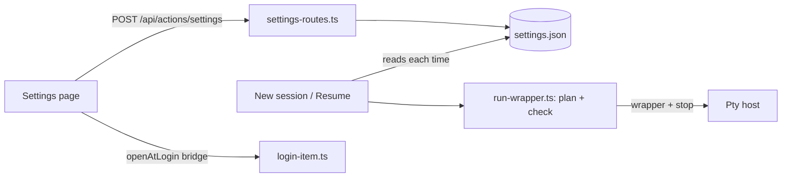

# Settings

## What it is

The settings page sets four things: Open at login, the scrollback of new terminals, the run wrapper, and the stop command. It opens from the sidebar's **Settings** button (`#settings`), the tray's **Settings**, and **Open settings** under a wrapper error. The server keeps three values in `<config>/settings.json`; Open at login is not there, it is the OS login item.

## How it works

- **File** (`settings-store.ts`): `{v: 1, scrollback?, runWrapper?, stopCommand?}`, read at each use with no cache, written by temp file and rename (0600). An absent key is the default; `""` means none. A bad file or key falls back to defaults with one log line.
- **Defaults:** scrollback 5,000 (100 to 100,000). Linux wrapper `systemd-run --user --scope --quiet --unit=openaflow-run-{runId}.scope` and stop `systemctl --user stop openaflow-run-{runId}.scope`. macOS: both empty. Windows: no wrapper, stored texts ignored.
- **Text rules** (`run-wrapper.ts`): at most 1,024 characters, space-separated words, quotes group. Placeholders `{runId}` and `{unit}` fill per word. The first word must be an absolute file or a name found on PATH.
- **At each start** (Linux, macOS): a changed wrapper is run once around `true` with a fresh id (5 s limit). A pass is kept for the server's life. A refusal answers `409 run wrapper: <word>` or `409 stop command: <word>`, and the form shows **Open settings**.
- **Routes:** `GET /api/settings` (token, else `403`) and `POST /api/actions/settings`. `SettingsView` carries the texts, `isDefault`, and a `preview` of the full command.
- **Load failures** (`settings-client.ts`, `settings-view.ts`): a network failure, a timeout, or any other bad answer shows "Couldn't load settings. Please try again" with **Try again**, which loads again. A `403 bad token` or a missing token shows the reload words with **Reload** (`location.reload()`). The token lives in the page, so only a reload gets a new one. The desktop shell reloads its window itself after it restarts the server (`window-rules.ts`, `afterRestart`); the button covers a page the shell didn't reload.
- **Open at login** (`login-item.ts`, `login-autostart.ts`): Windows and macOS use Electron's login item with `--hidden`. Linux writes `<autostart dir>/openaflow.desktop`. At each AppImage start, `repairLoginItem` points our own on entry at the new file after an update.
- **Electron checks** (`real-settings.test.ts`, fixture `settings-claude.mjs`): scrollback 200 applies to new sessions only; a changed wrapper gets the marker; a wrapper exiting 3 stops the start with Open settings; Open at login writes and deletes the file; Windows has no wrapper section. CI runs it unpackaged.

**Worked example.** You put a script that prints `bad option` and exits 3 in Wrapper command. New session answers `409 run wrapper: exit 3: bad option`, no record is made, and the form says "Your run wrapper failed:" with **Open settings**. **Reset to default** restores the Linux default, and the next start succeeds.

## Why it's this way

- **A wrapper check before the first start:** a broken wrapper would fail inside the terminal with no word to show. It runs around `true` with a fresh id, so it never touches the session's own scope.
- **The default stop only with the default wrapper:** the default stop names the default scope unit, which another wrapper does not create.
- **Linux writes an autostart file:** Electron's login item does nothing there. The file follows XDG rules (GNOME, KDE).
- **Read at each use:** a hand edit or a second server applies at the next start. Turned down: a cache.
- **Settings page now** (human, plan Q6). Turned down: leaving it to a later plan.

## Watch out

- `GET /api/settings` waits for the scope probe, up to about 6 s after a start.
- A wrapper that passed its check passes until the server restarts; a later break fails inside the terminal.
- `POST` with a wrapper key on Windows is `400 bad request`.
- `POST /api/actions/settings` is one more token-gated way to choose a program the app runs, as `tool-path` is.
- Two AppImages at different paths: the last one started owns the entry.
- `real-settings` writes the real `HKCU` Run value on Windows only with `CI=true`. Never set `CI=true` on your own machine. Other tests use a temp `OPENAFLOW_AUTOSTART_DIR`, never `~/.config/autostart`.
- After an API restart the page's token is stale. A load that gets `403 bad token` (or finds no token) shows "OpenAFlow restarted in the background. Reload to continue" with a **Reload** button, which reloads the page: **Try again** would send the same token. A save after a restart (or with no token) shows the same words, "OpenAFlow restarted in the background. Reload to continue", under the field, with no Reload button and no `aria-invalid`.

## History

- 2026-11-15 · settings S4 · added: `settings.json`, the command text rules, the wrapper check, the run wrapper and stop command at each start, `scrollback` and `stop` on records, the sweep's stored stop, and the settings routes.
- 2026-11-15 · settings H3 · added: `StartSpec.scrollback` and `bad scrollback` in the pty host.
- 2026-11-15 · settings D3 · added: Open at login (the Linux autostart file, Electron's API elsewhere), its preload calls, and the tray's Settings.
- 2026-11-17 · settings W4 · added: the settings page on `#settings`, Back, and the sidebar's Settings button.
- 2026-11-17 · settings W5 · added: Open settings on a wrapper error, in the New session form and the stop bar, and the view's scrollback from the session.
- 2026-11-18 · settings X3 · added: `real-settings.test.ts` with the `settings-claude.mjs` fixture, and its CI step; `real-folder-bridge` joins CI.
- 2026-11-19 · plan fix · changed: at start, an AppImage points its own on autostart entry at its new path after an update (`login-item.test.ts` › `linux repair at start`).
- 2026-11-19 · plan terminal-host complete · folded the Electron checks into the five headings; added the diagram and example · [report](../reports/terminal-host.html), [PR #155](https://github.com/alvionlabs/openaflow/pull/155)
- 2026-11-19 · task settings-retry-ci-rename · fixed: after an API restart the settings load shows the reload words and a Reload button, not "Try again" in a loop (`settings-client.test.ts`, `settings-view.test.ts`).
- 2026-11-19 · task settings-retry-ci-rename · fixed: a settings save after an API restart (or with no token) shows "The app restarted. Please reload", not the shared "The board restarted" words (`settings-client.test.ts` › `a refused save`).
- 2026-11-19 · task settings-retry-ci-rename · the reload words are now "OpenAFlow restarted in the background. Reload to continue" on the Settings load and save (the shared `RELOAD` constant); the human chose them (see decisions.md).
