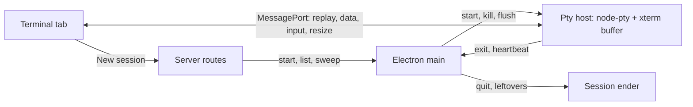

# Terminal host

## What it is

The desktop app runs each `claude` session in its own process, the pty host. A session lives in the host, not in the window, so it outlives a reload, a hidden or closed window, and a server crash. The window reads and types through a `MessagePort`. The server starts sessions and keeps their records ([hosted-sessions.md](hosted-sessions.md)); the page shows them in the Terminal tab. Windows and Linux are real targets; the browser build has no terminal.

## How it works

- **Host** (`packages/pty-host`): a second `utilityProcess` with `node-pty@1.2.0-beta.18` (pinned) and a headless xterm per session. `started` waits for the pid (about 1 s on Windows). It beats every 5 s. Scrollback comes from the start spec (default 5,000).
- **Window port** (`terminal-port*.ts`): only the app window's main frame gets one. It may only `attach`, `detach`, `input`, `resize`, `ack`; anything else answers `not allowed`. `attach` sends one `replay`, then live `data`, so a window sends `resize` first.
- **Starter** (`pty-host-starter.ts`): forks the host after the server is ready, watches the beat (`unresponsive` at 11 s), and restarts a dead host up to 5 times. After that it is `failed`.
- **Saved screens**: the host writes each screen to `<config>/screens/<marker>.txt` every 10 s, at exit, and at quit (0600).
- **Ending sessions** (`session-ender.ts`, `quit-flow.ts`, `windows-jobs.ts`): a quit asks first. A yes flushes screens, runs the record's stop command, then SIGHUP, SIGTERM, SIGKILL on the pty group, its descendants, and anything with the run marker in its env. Windows uses a Job Object helper.
- **Hooks plugin** (`packages/hooks-plugin`): `record.sh` (POSIX `sh`) appends each hook event to `<config>/hooks/<marker>.jsonl`, folder 0700, file 0600.
- **Start command** (`session-command.ts`): `claude --session-id <id> --plugin-dir <dir> "/pod:<skill> <text>"`. No print, permission, or model flag.

**Worked example.** You pick Plan and type "add tags". The server saves a `starting` record and sends `start` with the argv. Main asks the host, which spawns `claude` in the repo and answers `started` with its pid. The tab attaches and replays. The `SessionStart` hook line marks the record hooked. Kill the host: the record reads `stopped · terminals restarted`, and Resume runs `claude --resume`.

## Why it's this way

- **Own process, not the main process:** a server crash or reload never ends a session, and a node-pty crash never takes the board down. Terminal bytes skip main.
- **node-pty upstream, pinned** ([decision](../decisions.md#2026-11-13--keep-node-pty-after-the-windows-test-human-decision)): VS Code's terminal runs on it. Turned down: forks with prebuilds and `zigpty`; `@lydell/node-pty` is the fallback.
- **No automatic input** ([decision](../decisions.md#2026-11-13--the-terminal-host-is-three-plans-in-a-row-human-decision)): the skill goes in the start argument; nothing is written into a running session. Turned down: writing the command into the pty.
- **Quit asks, then ends the tree:** a session's dev servers would otherwise outlive the app. Turned down: leaving them running.
- **Linux as an AppImage:** no root, updatable in place. Turned down: `.deb`, `.rpm`, Flatpak.

## Watch out

- A quit ends every process the session started, dev servers included.
- A `--test-hooks` build exposes `__openaflowTest.terminals`. Never ship or install one; `release:check` refuses it.
- Tests use a fake `claude` behind `OPENAFLOW_CLAUDE_BIN`. `real-claude-start` needs `OPENAFLOW_REAL_CLAUDE=1` and its own signed-in `OPENAFLOW_REAL_CLAUDE_CONFIG_DIR`. Never use `~/.claude`.
- Never stop `openaflow-run-*` scopes by wildcard: your own sessions use that prefix.
- A kill while a session waits for its pid can let the program run a moment on Windows.
- On Windows a program's children can start before the job assign (0.4-1.4 s); the helper adds them later. The helper's C# travels encoded; keep its command line under 24,000 characters.
- `pnpm test:electron <name>` matches by substring: `real-terminal` also runs `real-terminal-tab`.
- Never ran: `real-exit`, `real-toast`, and every real-`claude` proof beyond host-core A1 (trust prompt, real Resume, tool hooks). The Windows hand checks are in the queue.

## History

- 2026-11-14 · host-core N1: node-pty proved in Electron, unpackaged and packaged; test hooks and the Electron harness.
- 2026-11-14 · host-core C1: `real-start` (the app starts on Linux and its server follows it) and the folder bridge test on Linux.
- 2026-11-14 · host-core K1: the hooks plugin and the hook-state reader.
- 2026-11-14 · host-core H1: the full host protocol: attach and replay, input, resize, flow control, heartbeat, kill, dispose, list.
- 2026-11-14 · host-core S1: the starter (ready wait, heartbeat, 5 restarts, stop) and the window link.
- 2026-11-14 · host-core P1: the Linux AppImage, the release workflow's Linux build, and `verify (ubuntu-latest)`.
- 2026-11-14 · host-core A1: the start command and the skill list, proved with real `claude` on Linux.
- 2026-11-14 · host-core E1: `real-terminal`, the `electron` CI jobs on both systems, and this page.
- 2026-11-14 · terminal-tab X1: `real-claude-start` runs only with `OPENAFLOW_REAL_CLAUDE_CONFIG_DIR`, a separate signed-in Claude Code config folder it gives `claude` as `CLAUDE_CONFIG_DIR`. It refuses `~/.claude`, the home folder, and the caller's own `CLAUDE_CONFIG_DIR`, and says why it skips. Proofs added for `SessionStart` around the trust prompt and the tool hooks; not run yet.
- 2026-11-15 · terminal-tab E2: `real-session` (hosted sessions through the routes, with a fake `claude`, unpackaged and packaged; the Windows npm shim and `cmd.exe` routes), the harness's `dir` option, and its CI steps.
- 2026-11-15 · session-life X2: `real-quit` and `real-resume` with the `life-claude.mjs` fixture, their CI steps (`real-resume` also packaged), the real-`claude` Resume proof (not run yet), and the harness reads main's process once, at launch.
- 2026-11-15 · session-life W3-fix: on Windows, the job helper also puts the children a session started before its assign in the job, so a quit and a crash end them. The harness's `pid`, `exited()`, and fallback kill act on main, not on Playwright's `cmd.exe`. On Windows, `real-quit` prints each child's spawn time and the job lines.
- 2026-11-15 · settings W1-fix: on Windows, a session whose program ended before its job assign (a host crash while the helper starts) keeps its job, and its children join by parent pid, so close and the helper's exit end them. A failed assign names its Win32 call. `real-quit` › `host crash before the job`, and the fixture's `early-gate`.
- 2026-11-15 · settings H3: a session's scrollback comes from `StartSpec.scrollback`, with `bad scrollback` after `bad screen file`; absent, the host's own value.
- 2026-11-18 · settings X3: `real-settings` with the `settings-claude.mjs` fixture; `real-folder-bridge` and `real-settings` join both `electron` CI jobs.
- 2026-11-19 · plan fix: `record.sh` keeps the hooks folder 0700 and the hook file 0600 on POSIX (`record.test.ts` › `record.sh file modes`).
- 2026-11-19 · plan terminal-host complete · rewrote this page to the current state; plan fix keeps the hook file private · [report](../reports/terminal-host.html), [PR #155](https://github.com/alvionlabs/openaflow/pull/155)
- 2026-11-27 · task pre-v010-fixes · tested: `real-quit` › `quit ends an orphan` (a grandchild whose parent ended before the quit) and › `quit ends a child with its own console` (Windows; `Start-Process -WindowStyle Hidden`, its own conhost.exe; skipped with a printed reason elsewhere). Both start their children after the session joins its job; on Windows both pass. `life-claude.mjs` gained the `orphan` and `console` kinds and each child's `ppid`.
