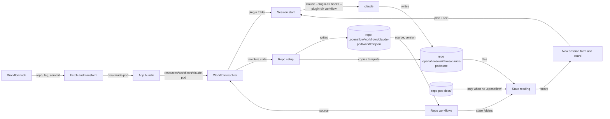
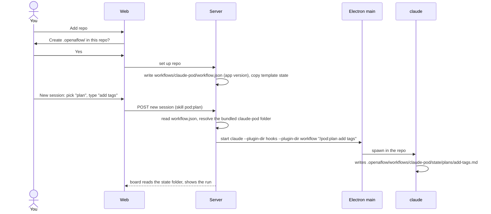

# Plan: Default workflow

_Generated: 2026-11-23 · Status: active · Grilled-with: pod (fast)_

Port base: 3200

<!-- autopilot-run: started=2026-11-24T04:08:43Z sprints=0 waves=0 -->

## Goal
OpenAFlow ships its own default workflow, reused from a pinned claude-pod release. Each repo keeps everything OpenAFlow-related in one `.openaflow/` folder. A `workflows/` subfolder holds one folder per workflow, and claude-pod is the first one: the repo commits which version it uses and the workflow's state. The workflow's skills and agents ship in the app. This is plan B of three: `terminal-host`, then `default-workflow`, then `automatic-input`.

## Why
OpenAFlow and claude-pod are two separate projects. OpenAFlow works on its own, and claude-pod works on its own. The only link is that OpenAFlow reuses claude-pod's workflow (human, 2026-11-23). A repo can be shared by many developers, so the workflow choice and its version are committed in the repo, and everyone runs the same one. Users may later have several workflows and pick one per feature, so each workflow gets its own folder from the start. Dropping claude-pod later means removing one folder, not changing code.

Success for this plan:
- In the installed app, on Windows and on Linux, you add a repo and agree. `.openaflow/workflows/claude-pod/` appears, with `workflow.json` and the template state.
- You start a session that you pick as `plan` in New session. The run writes only to `.openaflow/workflows/claude-pod/state/`, and the board shows it.
- No step of this needs claude-pod installed.

Constraints:
- v0.1.0 waits for this plan (decision 2026-11-13).
- claude-pod's repo stays the one source of the workflow (decision 2026-11-22). OpenAFlow makes no change in claude-pod.
- OpenAFlow bumps its claude-pod version only when it wants to. It doesn't follow claude-pod's releases.
- Research: [default-workflow.md](../research/default-workflow.md).

## Scope
**In scope:**
- **Folder layout per repo:** `.openaflow/workflows/<name>/workflow.json` (`{ "source": "claude-pod", "version": "<x.y.z>" }`) and `.openaflow/workflows/<name>/state/`. Both are committed (decision 8).
- **Workflow lock in OpenAFlow:** a committed lock file with claude-pod's repo, tag, and commit. A `bump-workflow <tag>` command rewrites it.
- **Fetch and transform at build time:** fetch the pinned tag with `git`, and fail if it isn't the locked commit. Copy only the plugin parts: `.claude-plugin/`, `skills/`, `agents/`, `docs/`, and `LICENSE`. (`skills/code` reads `${CLAUDE_PLUGIN_ROOT}/docs/design.md`.) Rename `pod-docs` to `.openaflow/workflows/claude-pod/state` in every file and in the scaffold folder. A check fails the build if any `pod-docs` is left.
- **Bundling:** the transformed plugin goes into the app at `resources/workflows/claude-pod` through `extraResources`, beside the hooks plugin. The install check and the third-party notices list it, with claude-pod's MIT license.
- **Loading:** the workflow resolver reads the repo's `workflow.json` and returns the bundled folder of its `source`. Every hosted session starts with that folder as a second `--plugin-dir`, beside the hooks plugin. Later, a `plugin/` folder beside `workflow.json` can take the bundled one's place: that is the seam.
- **Version mismatch:** when the repo pins another version than the app ships, New session says "This repo uses claude-pod 0.11.9; the app has 0.12.0". The **Use 0.12.0** button rewrites `workflow.json`. Sessions still start with the app's version.
- **Version line:** New session shows "Workflow: claude-pod 0.11.9". In a hosted session, the bundled `pod` replaces an installed claude-pod with no message from Claude Code, so this line makes it visible.
- **Bare skill names:** the New session dropdown shows `init`, `plan`, `ship`, `task`, `research`, `idea`, and Plain session, with no `pod:` prefix. The app still sends the full ID (`/pod:plan …`). `init` maps the project (the scout's codebase brief and smoke recipe), which the template copy alone doesn't do.
- **State reading:** the model, the file reader, the watcher, and the queue writer read every `.openaflow/workflows/*/state/`. In a repo with no `.openaflow/`, they read `pod-docs/` as today. A queue answer goes to the queue file of the folder that the run came from.
- **Repo setup:** Add repo asks to create `.openaflow/workflows/claude-pod/`, with `workflow.json` at the app's version and the template state. A repo that is already in the list and has no `.openaflow/` gets the same offer in New session before the first start.
- **README:** change the line "it never writes inside a repo". The app now writes `.openaflow/`, after you agree.
- **`disableSideloadFlags`:** when an organization blocks `--plugin-dir`, `claude` exits at start. The Terminal tab says why and names the setting.

**Out of scope:**
- A workflow picker in New session. It comes when a second workflow exists (Q27). The folder layout and state reading support several workflows already.
- Editing or replacing a workflow, including a `plugin/` folder in the repo and using an installed claude-pod. Parked: [replace-the-workflow](../ideas/replace-the-workflow.md).
- Downloading the version a repo pins when the app ships another (Q26 c). It goes in a later plan.
- Removing `pod-docs/` support. Parked: [drop-pod-docs-support](../ideas/drop-pod-docs-support.md).
- Any change in claude-pod, including queue lines 18 and 22 (pod side). They stay PENDING.
- Renaming `pod-ports` or `pod-staging`. Parked: [rename-pod-ports-staging](../ideas/rename-pod-ports-staging.md).
- A CI job that flags a newer claude-pod tag. Parked: [newer-claude-pod-check](../ideas/newer-claude-pod-check.md).
- Unprefixed skills in the terminal. Plugin skills always carry the prefix, and `/plan` and `/init` are Claude Code built-ins (Q17).
- Automatic input. That is plan `automatic-input`.

## How it fits together

**Parts:**

| Part | New or changed | Where (existing folder or module) | Does |
|------|----------------|-----------------------------------|------|
| Workflow lock | new | `packages/workflow` | Holds claude-pod's repo, tag, and commit. `bump-workflow <tag>` rewrites it. |
| Fetch and transform | new | `packages/workflow` (build script) | Fetches the tag, checks the commit, copies the plugin parts, renames `pod-docs`, and fails on any leftover. Writes `packages/workflow/dist/claude-pod`. |
| App bundle | changed | `packages/desktop` (build config, install check, notices) | Ships the transformed plugin in `resources/workflows/claude-pod`, beside `hooks-plugin`. |
| Repo workflows | new | `packages/model` | Reads `.openaflow/workflows/*/workflow.json` and gives each workflow's name, source, version, and state folder. Falls back to `pod-docs/` when the repo has no `.openaflow/`. |
| Workflow resolver | new | `packages/desktop` (next to the hooks plugin path) | Maps a workflow's `source` to its bundled folder, packaged or from the repo. This is the seam for a later `plugin/` folder. |
| Session start | changed | `packages/desktop`, `packages/server` (session routes) | Adds `--plugin-dir <workflow>` to every hosted `claude` start. Reports a sideload block as a stop reason. |
| State reading | changed | `packages/model` (run model), `packages/server` (repo files, watcher, queue writer) | Reads runs from each workflow's state folder, and writes answers back to the same folder. |
| Repo setup | new | `packages/server` (folder list, add repo), `packages/web` | Writes `workflow.json` and copies the template state after you agree. Rewrites `workflow.json` on **Use \<version\>**. |
| New session form | changed | `packages/web` screens/runs, `packages/server` (skill list) | Bare skill names, the version line, the mismatch notice, and the setup offer. |
| Terminal tab | changed | `packages/web` screens/runs | Shows the sideload block message in the stop bar. |

**How they connect:**

**Main flow:** you add a new repo and start a plan.

**Data:**
- **Workflow lock** (`packages/workflow`, committed in OpenAFlow; `bump-workflow` writes it, and the build reads it): repo URL, tag, and commit.
- **Transformed plugin** (`packages/workflow/dist/claude-pod`, not committed; the build writes it, and the app bundle reads it): claude-pod's plugin parts with the new state path, and its `LICENSE`.
- **`workflow.json`** (`<repo>/.openaflow/workflows/<name>/`, committed in the repo; repo setup and **Use \<version\>** write it, and the server reads it): `source` and `version`.
- **Workflow state** (`<repo>/.openaflow/workflows/<name>/state/`, committed in the repo; repo setup creates it, the workflow writes it, and the server reads it): the same files that `pod-docs/` holds for claude-pod.
- **`pod-docs/`** (in a repo with no `.openaflow/`; claude-pod writes it, and the server reads it): read as today.

## Sprint sequence

| Sprint | Goal | Status | Depends on |
|--------|------|--------|------------|
| default-workflow | Pin, transform, bundle, and load claude-pod as a workflow in `.openaflow/workflows/`; read every workflow's state with the `pod-docs/` fallback; repo setup; version notice; bare skill names | planned | — |

Status: `planned` / `active` / `done`. `Depends on` is the only dependency between sprints.

## Look
No new look (human, Q15). The UI changes are small and use the current look.
- **Thesis, palette, type, and layout:** as in `DESIGN.md` and `packages/web/src/theme/tokens.css`. No new tokens.
- **New session:** the "Start with" dropdown lists bare names (`init`, `plan`, `ship`, `task`, `research`, `idea`, Plain session). A muted line under the button reads "Workflow: claude-pod \<version\>".
- **Version mismatch:** one muted line above the button, "This repo uses claude-pod \<x\>; the app has \<y\>", with a secondary **Use \<y\>** button.
- **Setup offer:** a plain confirm after Add repo ("Create `.openaflow/` in this repo?"). The same line, with a **Set up** button, shows in New session for a repo without the folder.
- **Sideload block:** the stop bar line names `disableSideloadFlags`.
- **Rules out:** a new screen, a new palette, or a new kind of sidebar row.
- **Draft:** none. The terminal-host draft `pod-docs/design-drafts/terminal-host-look.html` shows the current New session form.

## Key decisions
- **Two separate projects** (human, 2026-11-23). OpenAFlow reuses claude-pod's workflow and nothing else. This settles the open points of the [2026-11-22 decision](../decisions.md#2026-11-22--openaflow-ships-claude-pod-as-its-default-workflow-human).
- **One `.openaflow/` per repo, with a folder per workflow** (human, 2026-11-23). claude-pod is the first workflow in `workflows/`. Plain claude-pod still writes `pod-docs/` on its own. A claude-pod folder-name setting was rejected: it would make claude-pod change for OpenAFlow's sake.
- **The repo commits a pin, not a copy** (human, Q25). `workflow.json` holds the source and the version, so a team shares one workflow, and a bump is a one-line diff. A full workflow copy in each repo was rejected: it is about 1.7 MB per repo and goes stale on every bump.
- **Version mismatch: a notice and a button, no block** (Q26 a). Downloading the pinned version goes in a later plan.
- **No picker until a second workflow exists** (Q27 a). The layout and state reading already handle several workflows.
- **Rename at build time** (human, Q9). claude-pod stays unchanged, and a version bump re-runs the transform. A check makes a leftover `pod-docs` fail the build. A fork was rejected (two copies to keep in step, decision 2026-11-22).
- **The workflow's skills and agents live in the app** and load with `--plugin-dir` (Q3).
- **Pin OpenAFlow's copy with a lock file and a `git` fetch checked against the commit** (Q4). A submodule was rejected: every clone and CI job needs `--recurse-submodules`. An npm `github:` dependency was rejected: it runs install scripts. A tarball SHA-256 was rejected: claude-pod releases have no assets, and source tarballs are not assets ([research](../research/default-workflow.md)).
- **The bump happens only when OpenAFlow wants it** (human, Q8 and Q9). A one-line note goes in the release checklist.
- **The plugin keeps its prefix, and the dropdown hides it** (human, Q17). Plugin skills can't drop the prefix, and `/plan` and `/init` are Claude Code built-ins. Unprefixed skills through `--add-dir` were rejected: they would take `/plan` and `/init` away in hosted sessions, and the docs disagree on whether `--add-dir` loads them.
- **The manifest name stays `pod`** (default). The transform doesn't touch it. In a hosted session, the bundled `pod` replaces an installed claude-pod, so the session has one workflow and writes one folder. The app's parsers keep reading `pod:*` agent names. Renaming to `openaflow` would load both workflows in the same session.
- **The bundled copy wins in hosted sessions, and the version line shows it** (Q5).
- **The hooks plugin stays a second `--plugin-dir`.** An unchanged claude-pod can't hold OpenAFlow's hooks. This replaces terminal-host's "fold it into the full plugin". (default)
- **`pod-docs/` is read only in repos with no `.openaflow/`** (human, Q16 b and Q28). This replaces decision 25: the fallback stays until a later plan removes it. A `pod-docs/` run keeps today's actions (Workflow, merge, answer). (default)
- **The app sets up `.openaflow/`** after you agree (human, Q13 b and Q29; decision 2). The template comes from the bundled plugin, so it has one source. It holds placeholders until `init` maps the project, so the dropdown keeps `init`. (default)
- **Decision 7 changes** (Q12). Runs in your own terminal use claude-pod and write `pod-docs/`. The bundled workflow loads only in hosted sessions.
- **`disableSideloadFlags` gets a clear error, with no fallback** (Q6).
- **No claude-pod work** (Q7). Queue lines 18 and 22 stay PENDING.
- **Keep `pod-ports` and `pod-staging`** (human, Q14).
- **No `claude plugin validate` in CI.** CI has no `claude` binary. The leftover-`pod-docs` check and the install check cover the bundle. (default)
- **License:** claude-pod's MIT `LICENSE` ships in the bundle and is listed in `THIRD-PARTY-NOTICES.txt`. (default)

## Known risks
- **A text rename can break claude-pod logic,** for example a path built from parts (`'pod' + '-docs'`), a relative path that assumed one folder level, or text about `pod-docs/` that the rename makes wrong. Mitigation: the leftover check, and a smoke run of `init`, `plan`, and `task` in a test repo at each bump.
- **This repo's history disappears from the board** once it gets `.openaflow/`, because the board then stops reading `pod-docs/`. Mitigation: setup only happens when you agree, so you choose when. Plain Claude Code with claude-pod keeps working on `pod-docs/` either way.
- **The same-name replacement is silent** in Claude Code. Issue #35423 asked how a marketplace copy and a `--plugin-dir` copy combine and was closed with no maintainer answer. Mitigation: the version line, and a check on the pinned Claude Code version that the bundled `pod` replaces an installed `pod` and that its hooks run.
- **Team members on different app versions** see the mismatch notice, and one **Use** click changes the pin for everyone. Mitigation: the notice names both versions, and the change shows in git before it is committed.
- **The build needs `git` and the network.** Mitigation: skip the fetch when `dist/claude-pod` already matches the lock. CI already has both.
- **The bundled folder can be read-only** (install folder, AppImage mount). The workflow writes only to the repo, so this is not a problem. The hooks plugin already works from there.

## Open questions
- What is the oldest Claude Code version that supports two `--plugin-dir` flags? The research found no evidence. Check it on the oldest build you support.

## Verification
- A clean clone, then `pnpm build` and `pnpm package`, gives an app whose `resources/workflows/claude-pod` has `.claude-plugin/plugin.json` at the locked version and no `pod-docs` anywhere (`grep -r pod-docs` finds nothing).
- `bump-workflow <tag>` changes only the lock file. A tag that doesn't match its commit fails the build.
- In the installed app on Windows and on Linux, Add repo on a repo with no `.openaflow/` asks first. Then it creates `.openaflow/workflows/claude-pod/workflow.json` at the app's version, and the template state.
- New session shows bare skill names and "Workflow: claude-pod \<version\>". Starting `plan` runs `claude` with both `--plugin-dir` flags and `/pod:plan <text>`.
- That run writes `.openaflow/workflows/claude-pod/state/plans/<slug>.md` and nothing in `pod-docs/`. Its agents' Glob and Grep find files under the dot-folder. The board shows the run, and answering its queue writes that state folder's `handoff-queue.md`.
- With `workflow.json` set to another version, New session shows the mismatch notice. **Use \<version\>** rewrites the file, and the notice goes away.
- A repo with only `pod-docs/` shows its runs as today, and answering writes `pod-docs/handoff-queue.md`. A repo with both folders shows only the `.openaflow/` runs. When `.openaflow/` appears while the app runs, the board switches to it without a restart.
- With an installed `pod` of another version, a hosted session uses the bundled version, and its hooks still write the session ID.
- With `disableSideloadFlags` set in managed settings, New session ends with a stop bar that names the setting.
