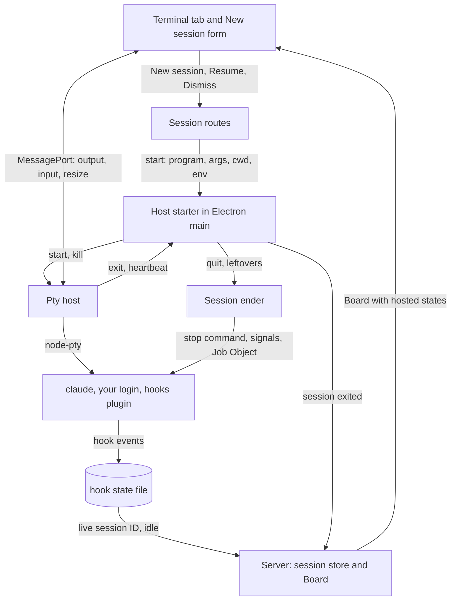
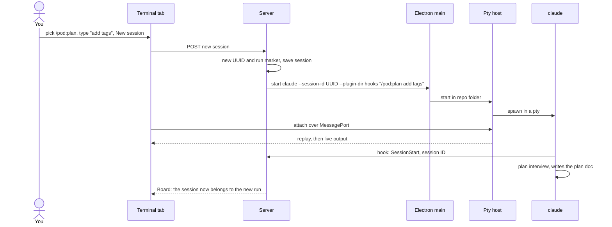

# Plan: Terminal host

_Generated: 2026-11-13 · Status: archived · Grilled-with: pod (fast)_
Port base: 8400
<!-- autopilot-run: started=2026-11-17T22:36:51Z sprints=1 waves=3 -->

## Goal
OpenAFlow hosts its own terminals. Each terminal runs the real, unmodified `claude` with your own login. You start, watch, type into, resume, and end sessions in the app, so you use OpenAFlow only and no separate terminal. This is plan A of three: `terminal-host`, then `openaflow-plugin`, then `automatic-input`.

## Why
The human, on 2026-11-13: "Without terminal host, this app is just a monitor tool. People still have to run Claude Code and run this app at the same time, which I won't even want to use. The goal is to have people use this app only and still manage everything else."

Success for this plan: in the installed app on Windows and on Linux, you pick a pod skill, start a session, work in it in the Terminal tab, close and reopen the window with no loss, quit with a confirm that leaves no `claude` or child process running, and resume the session after a restart.

Constraints:
- v0.1.0 waits for this plan and `openaflow-plugin` (human, 2026-11-13).
- Finish PR #108 (`ui-rework`) first: this plan builds on its run screen. Resume it with `/pod:autopilot`.
- Design and decisions come from the research: [terminal-host.md](../research/terminal-host.md), [terminal-host-spike.md](../research/terminal-host-spike.md), [automatic-input.md](../research/automatic-input.md), and [vscode-terminal.md](../research/vscode-terminal.md). Of its decisions 1–25, this plan puts 1, 3–7, 10–12, and 18–24 in force. Decisions 2, 8, and 25 (`.openaflow/`) go to `openaflow-plugin`; 9 and 13–17 (automatic input) go to `automatic-input`.

## Scope
**In scope:**
- A pty host: a second Electron `utilityProcess` with `node-pty@1.2.0-beta.18` (pinned) and a headless xterm buffer per session. Start, write, resize, kill, list, replay, heartbeat. The window talks to it through `MessagePort` only.
- Packaging node-pty outside the asar, proved on Windows and Linux, packaged and unpackaged.
- The desktop app starts on Linux. Today it doesn't: `startNotifier` calls `Notification.handleActivation`, a Windows-only API, which throws in `app.whenReady`, so the updater and the server never start (seen 2026-11-13, `pnpm desktop` on Fedora). Guard each Windows-only call by platform, and test the start on Linux.
- A Linux package: an AppImage for x64 from `pnpm package` on Linux, with `latest-linux.yml` for the updater, beside today's Windows NSIS installer. The release workflow builds it on `ubuntu-latest`. Today `packages/desktop/scripts/package.ts` builds the Windows installer only.
- A small OpenAFlow hooks plugin, no skills, loaded with `--plugin-dir`. Its hooks write the live session ID (with its cause) and hook state to a file in the app's config folder, keyed by the run's `OPENAFLOW_RUN` marker.
- **New session:** a dropdown of pod skills (`/pod:plan`, `/pod:ship`, `/pod:task`, `/pod:research`, `/pod:idea`, and Plain session) plus one text field. The app starts `claude --session-id <uuid> "/pod:<skill> <text>"` in the repo.
- The Terminal tab beside Waiting and Log, on a run and on a repo row with no plan. A terminal joins the run whose session it holds.
- Run states for hosted sessions: live, stopped (app closed, terminals restarted), ended, can't resume, waiting on the folder-trust prompt. **Resume** and **Dismiss**.
- The Next step card on a hosted run: **Open terminal** with "type `continue`" instead of a send.
- Session life: window close and reopen, server restart, host crash (restart up to 5 times), app crash, reboot, heartbeat banner, screens saved every 10 s.
- Quit: native dialog with **Cancel** as the default; "Ending N sessions…"; SIGHUP, SIGTERM, SIGKILL in parallel; process tree plus env marker; the default systemd scope on Linux; a Job Object on Windows. Leftovers ended after a host crash and at the next start after an app crash.
- Updates: install only on a quit with no live session, or after the same quit dialog.
- A settings page: Open at login, scrollback (5,000 lines default), and on Linux and macOS the run wrapper and stop command with a preview and **Reset to default**.
- Linux as a real target: a CI job on `ubuntu-latest` with `xvfb`, the Add repo folder dialog checked on Linux, and queue item 2026-11-05 (`utimes` after each config copy on POSIX, so `pruneLogs` keeps the right resume logs), which was due "before the Linux release".
- The browser build (decision 24): no Terminal tab and no New session form. A hosted run shows its state and its stop bar's words, with "Open the desktop app to use the terminal." in place of the buttons. Engineers check the non-terminal UI there, and the Terminal tab, New session, and Resume through the `_electron` checks.

**Out of scope:**
- Any automatic input into a hosted session: auto-continue, the send path, the gate, and their tests. Plan `automatic-input` (after v0.1.0).
- The `.openaflow/` folder, the claude-pod fork as OpenAFlow's plugin, and moving the hard-coded `pod-docs/` paths. Plan `openaflow-plugin` (before v0.1.0).
- The typing-wait setting (decision 9). It belongs to `automatic-input`.
- macOS builds and tests.
- A full run-screen redesign. The new UI fits the current screen.
- Changes to runs started in your own terminal: they stay watch-only with today's `claude -p --resume` runner (decision 7).

## How it fits together

**Parts:**

| Part | New or changed | Where (existing folder or module) | Does |
|------|----------------|-----------------------------------|------|
| Pty host | new | `packages/pty-host` | Holds every terminal: node-pty, a headless buffer per session, replay, heartbeat. Knows nothing of plans or pod. |
| Host starter | new | `packages/desktop` (next to the server host) | Starts the pty host, restarts it up to 5 times, watches the heartbeat, hands each window a `MessagePort`. |
| Session ender | new | `packages/desktop` | Ends a session's process tree: stop command, tree and marker snapshot, SIGHUP, SIGTERM, SIGKILL; Job Object on Windows. Runs at quit and on leftovers. |
| Linux package | new | `packages/desktop` (package script), `.github/workflows` (release) | An x64 AppImage with `latest-linux.yml`, beside the Windows installer. |
| Quit and update flow | changed | `packages/desktop` (quit, updater) | Quit dialog, "Ending N sessions…", install updates only after it. |
| Session store | new | `packages/server` | Per session: repo, session ID, run marker, start time, stop reason, last saved screen. In the config folder. |
| Session routes | new | `packages/server` (action routes) | New session, Resume, Dismiss. Builds the `claude` command line; the window never does. |
| Hooks plugin | new | `packages/hooks-plugin` (shipped in the app) | Writes the live session ID and hook state per run marker. |
| Run model join | changed | `packages/model` (runs) | Attaches a hosted session to its run or repo row; reports the hosted states. |
| Resume runner | changed | `packages/server` (resume, auto-continue) | Refuses any `-p` send to a hosted session. |
| Terminal tab | new | `packages/web` screens/runs | xterm.js view on the `MessagePort`, stop bar, Resume, Dismiss, Open terminal. |
| New session form | new | `packages/web` screens/runs | Skill dropdown, text field, start. |
| Settings page | new | `packages/web` (new screen), `packages/desktop` (login item) | Open at login, scrollback, run wrapper, stop command. |

**How they connect:**

**Main flow:** you start a plan from a repo with no plan.

**Data:**
- **Session store** (`<config dir>/sessions.json`, server writes, server reads): repo path, run marker, live session ID, start time, stop reason, path of the last saved screen.
- **Saved screens** (`<config dir>/screens/<run marker>.txt`, host writes every 10 s and at quit, server reads for the stop bar).
- **Hook state** (`<config dir>/hooks/<run marker>.jsonl`, hooks plugin writes, server reads): session ID changes with their cause, and the hook events the later `automatic-input` plan needs.
- **Settings** (`<config dir>/settings.json`, server writes and reads; main reads the login item): scrollback, run wrapper, stop command. Never in a repo.

## Sprint sequence

| Sprint | Goal | Status | Depends on |
|--------|------|--------|------------|
| host-core | The pty host, node-pty, the hooks plugin, and packaging (the Windows installer and a new Linux AppImage), proved on Windows and Linux; a session starts and replays | done | — |
| terminal-tab | New session with the skill dropdown, the Terminal tab, and the hosted run states on the current run screen | done | host-core |
| session-life | Quit, ending process trees, Resume, crashes, the heartbeat banner, and updates | done | terminal-tab |
| settings | The settings page: Open at login, scrollback, run wrapper, and stop command | done | session-life |

## Look
No new look. The human checked the new screens in the current look on 2026-11-13 ("The rest design looks very nice to me") and asked for one change: a skill dropdown in New session, now drawn in the draft.
- **Thesis, palette, type, and layout:** as in `DESIGN.md` and `packages/web/src/theme/tokens.css`. No new tokens.
- **Terminal:** background `--surface`, text `--fg`, cursor `--focus`, font `--mono` at 13 px, in light and dark.
- **Terminal tab:** after Waiting and Log, closed until opened, with a status dot when a session is live.
- **New session:** a "Start with" dropdown (label, slash command, one line on what it does), a text field, and a primary **New session** button.
- **Stop bar:** status dot, stop word, one muted line, **Resume** (primary) and **Dismiss**; the last screen faded below it.
- **Settings:** opened from the sidebar foot beside Add repo and from the tray; replaces the main column, with **Back**; each change saves at once.
- **Rules out:** a custom terminal theme, a new palette, a new kind of sidebar row.
- **Draft:** `pod-docs/design-drafts/terminal-host-look.html` (the current look, revised with the skill dropdown).

## Key decisions
- **Three plans in a row.** pod reviews code once at plan end, with at most 4 sprints, so the terminal host splits: this plan, then `openaflow-plugin`, then `automatic-input`. v0.1.0 waits for the first two (human, 2026-11-13).
- **No release before the terminal host** (human, 2026-11-13). This holds v0.1.0 past the `ui-rework` plan's "before v0.1.0".
- **node-pty, upstream `1.2.0-beta.18`, pinned** ([decision](../decisions.md)). The human's Windows test passed with node-pty; the agents there suggested another library, and the human chose to keep node-pty and fix problems later. Fallback: `@lydell/node-pty`.
- **The research's decisions 1, 3–7, 10–12, and 18–24 take effect here.** 2, 8, and 25 take effect in `openaflow-plugin`; 9 and 13–17 (typing wait, draft rule, and the send path) in `automatic-input`. Decision 7 applies here only in its watch-only part; outside runs write `.openaflow/` once `openaflow-plugin` lands.
- **A hooks-only plugin now.** Following the session ID after `/clear` needs `SessionStart`. The plugin ships in the app and loads with `--plugin-dir` (spike check 11). `openaflow-plugin` later folds it into the full plugin. (default)
- **No automatic input in this plan.** A hosted session gets no automatic send and no `-p` send. **Continue** on a hosted run opens the Terminal tab and says to type the word. (human, Q5)
- **New session uses a skill dropdown** (human, 2026-11-13; see [decisions](../decisions.md)). The skill and your text go to `claude` as its start argument. That is not automatic input: nothing is written into a running session, so the gate does not apply. Add it to the "Not automatic input" list in [automatic-input.md](../research/automatic-input.md).
- **The skill list is fixed in one module.** `/pod:plan`, `/pod:ship`, `/pod:task`, `/pod:research`, `/pod:idea`, Plain session. `openaflow-plugin` changes the prefix there. (default)
- **A terminal joins the run whose session it holds,** by the live session ID from the hook, matched to the run's transcripts. Before a plan exists it sits on the repo row. This replaces the research's "first transcript mention" proposal. (default)
- **New session is also in a repo's ⋯ menu,** so you can start a second session (for example `/pod:task`) while a plan runs. (default)
- **Settings page now** (human, Q6). Builds on the parked [settings-page](../ideas/settings-page.md) idea; Open at login returns there.
- **Linux is a real target.** CI adds an `ubuntu-latest` job with `xvfb` that runs the `_electron` terminal checks; Windows runs them on `windows-latest`. `real-*.test.ts` files run on Linux too. Builds on the parked `linux-macos-folder-dialog` idea, Linux only. (human, Q3)
- **Linux ships as an AppImage** (x64). It runs on any distro with no root, and electron-updater can update it in place, as NSIS does on Windows. Options not chosen: `.deb` or `.rpm` (one per distro family, and the updater can't install them without root); Flatpak (a sandbox that blocks running `claude`, `gh`, and `git` from the host). (default)
- **"Session" in the UI** for a terminal ("Quit and end sessions"); a row stays a "run". (default)
- **Decision 6 holds:** the current run screen gets the new tab and states, no redesign.
- **No Agent SDK, no API key, no `-p` for hosted sessions, never `--bare`.** The app never answers the folder-trust prompt and never reads credentials. (default, from the research's Policy)
- **An update never restarts the app while a session is live.** (default)

## Known risks
- **node-pty beta on Windows in a packaged app:** untested in this repo. Sprint 1 proves it first, packaged, on `windows-latest` and on a real Windows machine; fall back to `@lydell/node-pty`.
- **ConPTY behavior:** it repaints the screen, so resize, Ctrl+C, and Claude Code's full-screen UI may differ from Linux. Cover them in the Windows `_electron` checks.
- **Windows Job Objects:** untested. A detached child, such as a dev server, could survive quit. Sprint 3 tests it with the spike's kill checks.
- **Electron tests on CI:** `windows-latest` has a desktop; `ubuntu-latest` needs `xvfb`. If either can't run them, the human runs them by hand before the final PR.
- **This machine has no `xvfb`:** engineers here run `_electron` checks in the desktop session (`DISPLAY=:0`).
- **`pnpm verify` has 4 known Linux failures** in `packages/server` (spike notes). Fix or mark them in sprint 1, so a Linux CI job can pass.
- **Two hook sources:** a hosted session loads the hooks plugin and your installed pod plugin. They don't overlap in this plan, but a second installed copy of the hooks plugin would double events. Ignore duplicate events by session and time.
- **Policy:** Anthropic's rules may change. Check the legal page before the release (research Policy).

- **The start argument is unproved.** New session rests on `claude --session-id <uuid> --plugin-dir <dir> "/pod:plan <text>"` running the skill as the first turn. Not known: whether a slash command works as the start argument with those flags, what happens when the folder-trust prompt comes first, and how free text passes through `claude.cmd` on Windows (quotes, `%`, `^`, newlines). `host-core` proves it with real `claude` on both systems. Fallback: start with no prompt, prefill nothing, and show "Type `/pod:plan <your text>` in the terminal". Never write the prompt into the pty: that would be automatic input.

- **AppImage needs FUSE 2** on some distros (`libfuse2`). Fedora and Ubuntu 24.04 may lack it. The install note names the package, and `--appimage-extract-and-run` is the fallback.
- **The tray on GNOME** needs the AppIndicator extension. Without it, a closed window leaves no way back but starting the app again. The install note says so.

## Open questions
- What CI time the two `_electron` jobs add, and whether the Linux job runs on every PR or only on `pod-staging`.
- Whether `/pod:ship` from New session should warn that it runs autopilot.

## Verification
- `pnpm package` on Linux makes an AppImage; the release check installs nothing for it but starts it with temp folders and waits for `/api/health`.
- In the installed app on Windows and in the AppImage on Linux, with no build tools: New session with `/pod:plan` starts `claude` in the repo, and the Terminal tab shows it live; you can type in it and sign in.
- Close the window to the tray and reopen it, and reload it: the screen replays, and the session went on.
- Kill the server process: the terminal stays live, and the board comes back.
- Start a child dev server from the session, then quit and confirm: no `claude`, no child, and no listening port remain (`ps`/`ss` on Linux, `Get-Process`/`netstat` on Windows).
- Kill the pty host: the session reads `stopped · terminals restarted`; **Resume** brings back the old conversation.
- Kill the whole app, then start it: the session reads `stopped · app closed` with its last screen and **Resume**; nothing starts by itself.
- `/clear` in a hosted session keeps it on the same run with the new session ID.
- A hosted run's Continue opens the Terminal tab; the action log shows no `-p` send to a hosted session.
- The settings page changes scrollback and the run wrapper for new sessions; a broken wrapper you typed stops the start with the error and **Open settings**.
- `_electron` terminal checks pass in CI on `windows-latest` and `ubuntu-latest`; `pnpm verify` passes on both.

## Queue log

- `[2026-11-14 · PENDING · sprint-planner → human · plan: terminal-host · sprint: host-core]` decision: Ubuntu 24.04 blocks the Electron sandbox for AppImages by default, so users need `--no-sandbox` or an AppArmor profile. This is a security choice. Value in use: slice P1 describes the limit in `docs/install.md` and recommends no workaround. **Resolution:** 2026-11-19 — default recorded: accept the AppImage sandbox fallback, documented in `docs/install.md`; override anytime ([decisions.md](decisions.md#2026-11-19--electron-sandbox-off-on-ubuntu-2404-appimages-agent-default--override-anytime))
- `[2026-11-14 · PENDING · sprint-planner → human · plan: terminal-host · sprint: host-core]` decision: the new Electron and packaging CI jobs (Windows and Linux) run on every PR and on push to `pod-staging`, as `verify` does today. Option: run them only on `pod-staging`, to save CI time. Value in use: every PR. **Resolution:** 2026-11-19 — obsolete: decisions.md 2026-11-17 "CI once per sprint" replaced it; `pod-ci.yml` runs only on PRs into `pod-staging` or `main` and on push to `pod-staging`
- `[2026-11-14 · PENDING · sprint-planner → sprint-planner · plan: terminal-host · sprint: host-core]` session-life: nothing deletes the hook state files `<config dir>/hooks/<run marker>.jsonl`. Give pruning an owner (for example on Dismiss). **Resolution:** 2026-11-15 — obsolete: Dismiss deletes the hook file (terminal-tab S1), and session-life's Resume deletes the old record's hook and screen files
- `[2026-11-14 · PENDING · engineer → human · plan: terminal-host · sprint: host-core · slice: N1]` decision: the Windows package ships ConPTY's `conpty.dll` and `OpenConsole.exe` (from Windows Terminal, MIT, Microsoft) in node-pty's prebuilds. The notices carry node-pty's `LICENSE`, which has a Microsoft MIT block, but nothing names these two files. Value in use: node-pty's licence only. Option: add a line that names them. **Resolution:** 2026-11-19 — default recorded: node-pty's licence only, no line for the ConPTY files; override anytime ([decisions.md](decisions.md#2026-11-19--licence-notices-for-conpty-and-the-xterm-add-ons-agent-default--override-anytime))
- `[2026-11-14 · PENDING · engineer → human · plan: terminal-host · sprint: host-core · slice: N1]` decision: `@xterm/headless` and `@xterm/addon-serialize` ship no licence file, so `licence-notices.ts` uses the MIT `LICENSE` of github.com/xtermjs/xterm.js as their text. Value in use: that file. **Resolution:** 2026-11-19 — default recorded: xterm.js's MIT `LICENSE` as their text; override anytime ([decisions.md](decisions.md#2026-11-19--licence-notices-for-conpty-and-the-xterm-add-ons-agent-default--override-anytime))
- `[2026-11-14 · BLOCKED · engineer → orchestrator · plan: terminal-host · sprint: host-core · slice: N1]` the Windows proof (`pty proof (windows-latest)`) can't run: `pod-ci.yml` runs only on PRs and on push to `pod-staging`, and slice branches have no PR. **Resolution:** 2026-11-14 — SOLVED: the wave PR https://github.com/alvionlabs/openaflow/pull/117 runs the job
- `[2026-11-14 · PENDING · orchestrator → human · plan: terminal-host · sprint: host-core]` one-way door in PR #117 — slice C1: the one-time copy of the old config folder now keeps each file's modified time on Linux and macOS, undo: `git revert -m 1 3fa5f7d`; a copy that already ran stays as it is. **Resolution:** 2026-11-15 — accepted, PR #117 merged
- `[2026-11-14 · PENDING · engineer → sprint-planner · plan: terminal-host · sprint: host-core · slice: W1-fix]` NOTE for the slice that adds `kill` and `dispose` from main (S1 or session-life): node-pty on Windows holds `kill()` until the first data arrives, so a dispose while a session waits for its pid may let the program start and run briefly after `start-failed`. Check it on Windows (CI). **Resolution:** 2026-11-19 — obsolete: a kill before the pid now ends the session at once (03f79e9), and a pid that comes after the end is ended again (8eec8ae)
- `[2026-11-15 · PENDING · orchestrator → human · plan: terminal-host · sprint: host-core]` gate 6 (escalation-valve): wave 1 PR https://github.com/alvionlabs/openaflow/pull/117 withheld, one-way door in slice C1 (the one-time config copy keeps file times on Linux and macOS; undo: `git revert -m 1 3fa5f7d`). CI passed on Windows and Linux, and GitHub reads it as mergeable and clean. Merge it into `terminal-host` with a merge commit, then run `/pod:autopilot` to go on to wave 2. **Resolution:** 2026-11-15 — the human said to merge it; merged as c338045
- `[2026-11-15 · PENDING · engineer → sprint-planner · plan: terminal-host · sprint: host-core · slice: A1]` the cmd.exe route (`cmd.exe /d /c call <claude> …` for a shim the app can't read) runs nowhere yet, and K1's `PreToolUse` (no `matcher`) and `PermissionRequest` hooks never fired in the real run (the proof turn uses no tool). Give both a real check (E1 or terminal-tab). **Resolution:** 2026-11-15 — partly: the `cmd.exe` route ran on `windows-latest`, unpackaged and packaged (E2, `real-session.test.ts › windows shims`); the `PreToolUse` and `PermissionRequest` hooks still wait for X1's real run
- `[2026-11-15 · PENDING · engineer → human · plan: terminal-host · sprint: host-core · slice: A1]` decision: where the spec is silent, `session-command.ts` allows plain text that starts with `/` (it runs as a slash command), requires absolute `claude` and config paths, and adds the error words `bad skill`, `bad path`, `cmd.exe not found`, and `unsafe claude path` (a path with `" % ! ^ & | < > , ; =` or a line break). Value in use: this. **Resolution:** 2026-11-19 — default recorded: the rules and error words as built; override anytime ([decisions.md](decisions.md#2026-11-19--new-session-command-rules-the-spec-left-open-agent-default--override-anytime))
- `[2026-11-15 · PENDING · engineer → human · plan: terminal-host · sprint: host-core · slice: A1]` now: each real-claude proof run (`OPENAFLOW_REAL_CLAUDE=1`) leaves a transcript folder under `~/.claude/projects/` (named after `/tmp/oaf-real-claude-*`) and a folder-trust entry in `~/.claude.json`, in your real Claude Code config. 5 runs so far; nothing deleted. Option: point the test at a temp `CLAUDE_CONFIG_DIR`. **Resolution:** 2026-11-19 — obsolete: the real-claude proofs now run under `OPENAFLOW_REAL_CLAUDE_CONFIG_DIR` (X1); the 5 earlier runs' folders in `~/.claude` stay until you delete them
- `[2026-11-15 · BLOCKED · engineer → orchestrator · plan: terminal-host · sprint: host-core · slice: S1]` `real-folder-bridge.test.ts` (C1's file) asserts the page sees only `pickFolder`; §5 adds `connectTerminals` and `onTerminalHost`. **Resolution:** 2026-11-15 — SOLVED under gate 1's exception: the file went to S1, which updates the key list
- `[2026-11-15 · PENDING · engineer → human · plan: terminal-host · sprint: host-core · slice: S1]` decision: `onTerminalHost` doesn't give its current state to a page that subscribes late, so a page that loads after the host is ready never hears `ready`. Value in use: the page calls `connectTerminals()` and doesn't wait for `ready`. Also: a crash sends nothing to the page until the restarted host is ready (`restarted`), and a host whose node-pty fails to load still uses all 5 restarts. **Resolution:** 2026-11-19 — default recorded: no state replay to a late page; the page connects without waiting; override anytime ([decisions.md](decisions.md#2026-11-19--terminal-host-state-for-a-late-page-and-after-a-crash-agent-default--override-anytime))
- `[2026-11-15 · PENDING · engineer → sprint-planner · plan: terminal-host · sprint: host-core · slice: S1]` for E1 or the wave fix: `pty-host-starter.ts` defines its own `ListAnswer` and `SessionInfo` shapes, because `kill`, `list`, `connect`, and `beat` weren't in `protocol.ts` at its base. Switch to H1's protocol types once both merge. `createPtyHostClient` in `pty-host-launch.ts` is now dead code (only its test uses it). `kill` on Windows has no CI proof yet. **Resolution:** 2026-11-19 — obsolete: the starter takes its shapes from the pty host protocol (9cc0b48), `createPtyHostClient` is gone (da6b316), and `real-quit` runs `kill` on `windows-latest`
- `[2026-11-15 · PENDING · engineer → human · plan: terminal-host · sprint: host-core · slice: P1]` decision (updates the 2026-11-14 sandbox entry): electron-builder 26's AppImage `AppRun` runs `unshare -Ur true` at start and adds `--no-sandbox` by itself when that fails, so on Ubuntu 24.04 users probably run with Chromium's sandbox off without asking (read in the built AppImage; not run on 24.04). `docs/install.md` describes it. Options: accept it, or override `AppRun` to refuse the start. Value in use: accept. **Resolution:** 2026-11-19 — default recorded: accept the AppImage sandbox fallback; override anytime ([decisions.md](decisions.md#2026-11-19--electron-sandbox-off-on-ubuntu-2404-appimages-agent-default--override-anytime))
- `[2026-11-15 · PENDING · orchestrator → human · plan: terminal-host · sprint: host-core]` one-way door in PR #122 — slice P1: a version tag now also builds and publishes a Linux AppImage and `latest-linux.yml`, and a failed Linux build holds the Windows release, undo: `git revert -m 1 508a32f` before the next tag. **Resolution:** 2026-11-15 — accepted, PR #122 merged
- `[2026-11-15 · PENDING · orchestrator → human · plan: terminal-host · sprint: host-core]` gate 6 (escalation-valve): wave 2 PR https://github.com/alvionlabs/openaflow/pull/122 withheld, one-way door in slice P1 (a version tag now also builds and publishes a Linux AppImage, and a failed Linux build holds the Windows release; undo: `git revert -m 1 508a32f` before the next tag). No UI change. CI passed on Windows and Linux (4 checks), and GitHub reads it as mergeable and clean. Merge it into `terminal-host` with a merge commit, then run `/pod:autopilot` to go on to wave 3. **Resolution:** 2026-11-15 — the human merged PR #122 (9a4f13e)
- `[2026-11-15 · PENDING · engineer → human · plan: terminal-host · sprint: host-core · slice: E1]` decision: `real-start` runs unpackaged only (it starts Electron's own binary on `dist/main.cjs`, so `OPENAFLOW_PACKAGED_APP` has no effect); the scope said all three Electron files run unpackaged then packaged. Value in use: unpackaged only; `real-pty-proof` and `real-terminal` cover the packaged app. **Resolution:** 2026-11-19 — default recorded: `real-start` unpackaged only; override anytime ([decisions.md](decisions.md#2026-11-19--the-real-start-proof-runs-unpackaged-only-agent-default--override-anytime))
- `[2026-11-15 · PENDING · engineer → sprint-planner · plan: terminal-host · sprint: host-core · slice: E1]` session-life: on `windows-latest`, a kill right after a start met the session still waiting for its pid (`pid: 0`); the program started (pid 8472), ran for a moment, then ended. Decide whether a kill before the pid must stop the program from starting. Also not checked: a dead window port that never sends `close` could leave unacked characters and keep a session paused. **Resolution:** 2026-11-19 — obsolete: a kill before the pid ends the session at once (03f79e9, 8eec8ae); the dead-port part is the open H2 entry on unacked characters
- `[2026-11-15 · PENDING · sprint-planner → human · plan: terminal-host · sprint: terminal-tab]` decision: a hosted session joins a run only when an agent of that run holds one of the session's IDs. So a fresh `/pod:plan` whose plan doc exists before any agent holds that ID keeps its terminal on the repo row, beside the new plan run (the plan's main flow moves it to the run). Not checked against what a real `/pod:plan` leaves in the transcripts. Value in use: this. **Resolution:** 2026-11-19 — default recorded: join only through an agent's session ID; override anytime ([decisions.md](decisions.md#2026-11-19--a-hosted-session-joins-a-run-only-through-an-agents-session-id-agent-default--override-anytime))
- `[2026-11-15 · PENDING · sprint-planner → human · plan: terminal-host · sprint: terminal-tab]` decision (Look): the waiting card reads "Claude waits for you in the terminal" and "It may ask you to trust this folder or to sign in.", not the draft's "Claude asks to trust this folder" — the rule (live, no `SessionStart` hook line after 10 s) can't tell the trust prompt from a login screen. The stop bar has Dismiss only in this sprint; Resume, `can't resume`, and saved screens come in session-life. `/pod:ship` gets no warning in the Start with list. Value in use: this. **Resolution:** 2026-11-19 — default recorded: "Claude waits for you in the terminal"; override anytime ([decisions.md](decisions.md#2026-11-19--waiting-card-words-for-a-new-session-agent-default--override-anytime))
- `[2026-11-15 · PENDING · engineer → human · plan: terminal-host · sprint: terminal-tab · slice: X1]` decision: the real-claude gate also refuses the home folder (`claude` would write `~/.claude.json` there) and any folder inside `~/.claude` or inside the caller's own `CLAUDE_CONFIG_DIR`; the skip reason prints only when `OPENAFLOW_REAL_CLAUDE` or `OPENAFLOW_REAL_CLAUDE_CONFIG_DIR` is set. The three real proofs (no `SessionStart` before the trust answer, `SessionStart` within 10 s, `PreToolUse` then `PermissionRequest` for a Bash call) were written without a real run: the login screen pattern, the permission prompt's "Do you want" text, and the `PermissionRequest` payload shape are guesses, so the first real run may need small fixes. **Resolution:** 2026-11-19 — default recorded: the gate as built; override anytime ([decisions.md](decisions.md#2026-11-19--the-real-claude-test-gate-refuses-home-and-claude-config-folders-agent-default--override-anytime))
- `[2026-11-15 · BLOCKED · orchestrator → human · plan: terminal-host · sprint: terminal-tab · slice: M1]` gate 1 (blocked-concern): slice M1 can't pass `pnpm typecheck`. Contract §4 adds the action result `dismissed`, and `packages/web/src/screens/runs/action-log-view.ts:10` (`OUTCOME_CLS: Record<ActionEntry['result'], ChipClass>`) has no entry for it. No wave 1 slice owns that file (N1 owns it in wave 2), and it is product code, so gate 1's exception doesn't cover it. Proposed: give M1 that one line, `dismissed: 's-ok',`, and resume it. M1's other work is done (4 commits, 2,496 tests pass). **Resolution:** 2026-11-15 — the human said yes: M1 adds `dismissed: 's-ok'` to `OUTCOME_CLS` and finishes
- `[2026-11-15 · PENDING · engineer → human · plan: terminal-host · sprint: terminal-tab · slice: M1]` decision: a repo row that holds only a live hosted session has no activity time, so it sorts after every run with activity, and a just-started session can sit low in the sidebar. Option: use the newest session `startedAt` as its activity. Also: a repo that shows an error or `update pod` keeps its one row and state, so a waiting session there never reads `needs-you`. Value in use: both as built. **Resolution:** 2026-11-19 — default recorded: both as built; override anytime ([decisions.md](decisions.md#2026-11-19--sidebar-order-and-state-for-repos-with-hosted-sessions-agent-default--override-anytime))
- `[2026-11-15 · PENDING · engineer → human · plan: terminal-host · sprint: terminal-tab · slice: L1]` decision (Look): ANSI colours keep xterm's defaults (contract §8). On the light theme, xterm's default green `#0dbc79` on `--surface` `#fafafa` is about 2.5:1, so Claude's green text is hard to read (seen at 375 px light). Option: T1 sets xterm `minimumContrastRatio: 4.5`. Value in use: none set yet; T1 gets the note. **Resolution:** 2026-11-19 — obsolete: T1 sets xterm `minimumContrastRatio: 4.5` (`terminal-tab.ts`)
- `[2026-11-15 · PENDING · engineer → human · plan: terminal-host · sprint: terminal-tab · slice: L1]` decision (Look): the Start with list matches the draft (`--bg`, a `--border-strong` frame, 8 px radius, `0 8px 24px var(--shadow)`), not the app's `.menu` popup (`--surface`, 12 px radius, larger shadow), so the app now has two popup styles. Also: Tab or a click outside closes the open list and keeps the old pick, like Escape (the ARIA default picks the active option). Value in use: both as built. **Resolution:** 2026-11-19 — default recorded: both as built; override anytime ([decisions.md](decisions.md#2026-11-19--start-with-list-popup-style-and-close-rule-agent-default--override-anytime))
- `[2026-11-15 · PENDING · engineer → human · plan: terminal-host · sprint: terminal-tab · slice: D1]` decision: after the quit stops the starter, main answers nothing to the server (no `start`, `list`, `exit`, or `lost`), so the server doesn't write `stopped · terminals restarted` at quit. Value in use: silence. **Resolution:** 2026-11-19 — obsolete: session-life makes the quit silence read `stopped · app closed` after a restart (sprint session-life decision entry)
- `[2026-11-15 · PENDING · engineer → human · plan: terminal-host · sprint: terminal-tab · slice: S1]` decision: where the contract is silent or reads otherwise, the session store (1) reconciles only the `starting` and `live` records it held when it sent `list` (§3 says every unlisted `starting` record), so a New session during the up-to-20 s wait isn't marked closed; (2) sets `endedAt` only on `lost` and on an exit, never on `stopped · app closed` or reconcile's `ended`; (3) logs only a start (`started`, a 502 or 504 `failed`), and a late `started` after a 504 can make the session live while its log entry reads `failed`; (4) counts a record whose repo left the Board toward the cap of 10, with no way to dismiss it until the repo returns; (5) on a failed `sessions.json` write, logs one line, keeps the change in memory, and still starts. Value in use: all five. **Resolution:** 2026-11-19 — default recorded: all five as built; override anytime ([decisions.md](decisions.md#2026-11-19--session-store-rules-the-contract-left-open-agent-default--override-anytime))
- `[2026-11-15 · PENDING · engineer → human · plan: terminal-host · sprint: terminal-tab · slice: S1]` now (product choice): after a New session times out (504), its record stays `starting` (§3), so that repo answers `409 session starting` to every New session until a late answer or the next start's reconcile. A user who hits a slow start can't start another session in that repo. **Resolution:** 2026-11-19 — default recorded: the record stays `starting` after a 504; override anytime ([decisions.md](decisions.md#2026-11-19--a-start-or-resume-that-times-out-keeps-the-record-starting-agent-default--override-anytime))
- `[2026-11-15 · PENDING · engineer → human · plan: terminal-host · sprint: terminal-tab · slice: N1]` decision (copy): N1 wrote every New session error itself (`START_ERRORS` in `new-session-flow.ts`), for example `bad text` → "Use plain text on one line, up to 2,000 characters" ("A plain session can't start with a dash" for Plain session), `session starting` → "A session is already starting in this repo", `too many sessions` → "Ten sessions are open. End one, then try again", a failed start → "The session didn't start. Please try again". If the session isn't on the Board within 10 s: "The session started. It shows here once the board catches up". After a reload the line you were to type yourself is gone; the card reads "Type your start line in the terminal." until the session is prompted. The start card and ⋯ New session are left out on `error` and `update pod` repos. Value in use: all of this. **Resolution:** 2026-11-19 — default recorded: the `START_ERRORS` words as built; override anytime ([decisions.md](decisions.md#2026-11-19--new-session-error-words-agent-default--override-anytime))
- `[2026-11-15 · PENDING · engineer → sprint-planner · plan: terminal-host · sprint: terminal-tab · slice: N1]` for T1 or session-life: `WaitingTab.tsx` (no slice owns it) still mounts `ReplyPanel` for a hosted reply in the rest list, with Copy and "Run it yourself" (only `cd` and "This run's session is in the Terminal tab. Type the reply there."), and a waiting card that lands in the rest list shows title and detail with no Open terminal button. Give it Open terminal, or leave hosted rows out of it. **Resolution:** 2026-11-19 — obsolete: hosted rows in the Waiting tab show Open terminal and no ReplyPanel (46abbb2)
- `[2026-11-15 · PENDING · engineer → human · plan: terminal-host · sprint: terminal-tab · slice: T1]` decision (copy and Look): T1 wrote the browser line "The terminal started at HH:MM.", the stop line with no end time "The terminal has ended.", and the Dismiss errors (`DISMISS_ERRORS`, for example 409 `session is live` → "This terminal is still running, so it stays"). The line under the terminal shows the full repo path ("Live · `claude` in /full/path"), which wraps at 375 px; the draft shows `~/…`. The stop word is 14 px weight 500 (the draft's is 16 px). The stop bar has Dismiss and no Resume this sprint (plan Look and draft still show Resume; session-life adds it). Value in use: all as built. **Resolution:** 2026-11-19 — default recorded: all as built; override anytime ([decisions.md](decisions.md#2026-11-19--terminal-tab-words-and-stop-bar-look-agent-default--override-anytime))
- `[2026-11-15 · PENDING · engineer → sprint-planner · plan: terminal-host · sprint: terminal-tab · slice: T1]` session-life: untested in the Terminal tab — `starting` (attach held back until `live`), a host that fails or restarts ("This terminal is not available." and its recovery), the 409 alert under the stop bar, and the tab request from an engineer view (`#…/agent/<id>`, in `RunsScreen.tsx`). **Resolution:** 2026-11-19 — obsolete: `terminal-tab.test.ts` (host paths, focus request, the `starting` attach hold) and `dismiss-flow.test.ts` (409 alert) cover these states
- `[2026-11-15 · PENDING · sprint-planner → human · plan: terminal-host · sprint: session-life]` decision: after a confirmed quit, main stops sending `exit` and `lost` to the server, so those sessions read `stopped · app closed` after a restart (as the draft shows). A test-hooks build never opens the quit box and answers `end`. After the server fails for good, a quit ends sessions with no dialog (the error box came first). The quit dialog names sessions from the last list the server sent. The heartbeat banner shows only for `unresponsive`. The 504 that blocks a repo (S1 entry) stays at its value in use, also for Resume. Value in use: all of this. **Resolution:** 2026-11-19 — default recorded: all as built; override anytime ([decisions.md](decisions.md#2026-11-19--quit-and-host-state-rules-in-session-life-agent-default--override-anytime))
- `[2026-11-15 · PENDING · engineer → human · plan: terminal-host · sprint: session-life · slice: J1]` decision: the Windows Job Object helper's `close` waits at most 2 s (`CLOSE_MS`) for the PowerShell helper, then resolves anyway, so a stuck helper can't block a quit inside `endAll`'s 7 s budget. Value in use: 2 s. **Resolution:** 2026-11-19 — default recorded: 2 s; override anytime ([decisions.md](decisions.md#2026-11-19--windows-job-helper-close-wait-and-start-time-agent-default--override-anytime))
- `[2026-11-15 · PENDING · engineer → human · plan: terminal-host · sprint: session-life · slice: H2]` decision: a window port goes stale (stops holding the pty) 30 s after the later of the moment it went over the 100,000-character limit and its last message, so a port that was quiet before a burst doesn't go stale on the first burst. Value in use: this reading of §2. **Resolution:** 2026-11-19 — default recorded: 30 s after the later of going over and the last message; override anytime ([decisions.md](decisions.md#2026-11-19--when-a-window-port-goes-stale-agent-default--override-anytime))
- `[2026-11-15 · PENDING · engineer → human · plan: terminal-host · sprint: session-life · slice: E1]` decision: (1) `systemctl --user stop` on a scope that is already gone exits 5, so a session that already ended cleanly logs one `stop command failed: exit 5` line at every quit; option: count exit 5 (unit not loaded) as success. (2) A root pid whose own environment lacks `OPENAFLOW_RUN=<id>` (a reused pid) gets a marker-only end: no tree, no group, no SIGHUP. (3) A pid that arrives after its session was ended at pid 0 (for example `endAll` while it waited for its pid) is ended once more with the real pid, and `endAll` waits for it. Value in use: all three as built. **Resolution:** 2026-11-19 — default recorded: all three as built; override anytime ([decisions.md](decisions.md#2026-11-19--session-ender-edge-cases-on-linux-agent-default--override-anytime))
- `[2026-11-15 · PENDING · engineer → human · plan: terminal-host · sprint: session-life · slice: W3]` decision: the host banner hides when the terminal host is `failed` or `starting`; the contract names only `unresponsive`. On `failed`, the Terminal tab words the failure, and "the app keeps trying" would be false. Option: show the banner on `failed` too. Value in use: hidden on `failed` and `starting`. **Resolution:** 2026-11-19 — default recorded: hidden on `failed` and `starting`; override anytime ([decisions.md](decisions.md#2026-11-19--host-banner-hidden-when-the-terminal-host-failed-agent-default--override-anytime))
- `[2026-11-15 · PENDING · engineer → human · plan: terminal-host · sprint: session-life · slice: S3]` decision: after a Resume answers 504 (the start was slow), the old session record stays, as the contract says. If the new session then starts late, nothing removes the old record. When the new session ends, both rows read `ok`, and you can resume the same conversation from two rows. Option: a late `started` on a record with `resumedFrom` removes the old record. Value in use: the old record stays until you dismiss it. **Resolution:** 2026-11-19 — default recorded: the old record stays until you dismiss it; override anytime ([decisions.md](decisions.md#2026-11-19--a-start-or-resume-that-times-out-keeps-the-record-starting-agent-default--override-anytime))
- `[2026-11-15 · NOTE · engineer → orchestrator · plan: terminal-host · sprint: session-life · slice: S3]` a stored `resumedFrom` that is not a UUID v4, or sits on a record that is not `starting`, is dropped on read; the record stays. `actions.md`, `server.md`, and the smoke recipe don't mention Resume, `resume-session` entries, or the screen route (for X2).
- `[2026-11-15 · PENDING · engineer → human · plan: terminal-host · sprint: session-life · slice: D2]` decision: on Linux, a SIGTERM to the app (a logout, or `kill <pid>`) with a live session opens the quit box and waits for an answer, because nothing may end without a yes. Option: treat SIGTERM like Windows `session-end` (end sessions with no box). Value in use: the box asks. **Resolution:** 2026-11-19 — default recorded: the box asks; override anytime ([decisions.md](decisions.md#2026-11-19--quit-box-on-sigterm-and-on-a-failed-box-agent-default--override-anytime))
- `[2026-11-15 · PENDING · engineer → human · plan: terminal-host · sprint: session-life · slice: D2]` decision: if the native quit box fails (throws), the quit reads as Cancel and logs `quit question failed, so nothing ends`. With a broken box, the app can't quit while a session is live. Value in use: Cancel. **Resolution:** 2026-11-19 — default recorded: Cancel; override anytime ([decisions.md](decisions.md#2026-11-19--quit-box-on-sigterm-and-on-a-failed-box-agent-default--override-anytime))
- `[2026-11-15 · NOTE · engineer → orchestrator · plan: terminal-host · sprint: session-life · slice: D2]` for X2: `__openaflowTest.quit.answer('cancel')` applies to the next question only; trigger a quit with `app.evaluate(({app}) => app.quit())`; a confirmed quit takes up to 2 s flush plus 6–7 s of ends. For U2: `ctx.endSessions()` gives `true` with no live session, `false` on Cancel; a quit during its box is ignored. SOLVED: a disposed session no longer stays live in the roster (6ed39ef).
- `[2026-11-15 · PENDING · engineer → human · plan: terminal-host · sprint: session-life · slice: W2]` decision: on a Resume 504, the new record stays `starting`, so the Terminal tab shows that session on "Starting" and the line "The session didn't resume. Please try again" has no bar to show in. Tied to the S1 entry on the 504 value and the S3 entry on a late `started`. Value in use: the row shows "Starting". **Resolution:** 2026-11-19 — default recorded: the row shows "Starting"; override anytime ([decisions.md](decisions.md#2026-11-19--a-start-or-resume-that-times-out-keeps-the-record-starting-agent-default--override-anytime))
- `[2026-11-15 · PENDING · engineer → human · plan: terminal-host · sprint: session-life · slice: W2]` decision (words the spec didn't give): Resume error `no session` reads "This session is already gone"; `session is live` reads "This session is already running"; `bad request`, `no terminal host`, and `claude not found` reuse New session's words. The stop bar has one alert box with the error of the button pressed last; a Resume error hides once the bar reads "Can't resume". Value in use: these words and this rule. **Resolution:** 2026-11-19 — default recorded: these words and this rule; override anytime ([decisions.md](decisions.md#2026-11-19--resume-error-words-agent-default--override-anytime))
- `[2026-11-15 · NOTE · engineer → orchestrator · plan: terminal-host · sprint: session-life · slice: W2]` a `can't resume: <reason>` error keeps its period ("The session file is gone."), per the contract §9, against DESIGN.md's no-period rule. Resume sends no `cols`/`rows`; the view sends `resize` before `attach`. For X2: `tab-claude.mjs` reads `--resume` and writes `SessionStart` with source `resume`. SOLVED: the stop bar and the view shared a key, so the old bar stayed on "Resuming…" (3645719); at 375 px the bar squeezed (5778e69).
- `[2026-11-15 · NOTE · orchestrator → orchestrator · plan: terminal-host · sprint: session-life]` for X2: on the wave 2 head, one full `pnpm test:electron` run failed `real-terminal.test.ts › input from the window echoes back` at launch; the harness `close()` (`electron-harness.ts:111`, `app.process()`) threw `Cannot read properties of undefined (reading '_object')` and hid the first error. Passed in 3 later runs. Make `close()` safe when the launch failed, so the real cause shows.
- `[2026-11-15 · PENDING · orchestrator → human · plan: terminal-host · sprint: session-life]` one-way door in PR #141 — S3 keeps each session's saved screen on disk in `screens/` under the config folder, undo: `git revert -m 1 9f5c5e5` (after the D2 undo), then delete the `screens/` folder. **Resolution:** 2026-11-15 — accepted, PR #141 merged
- `[2026-11-15 · PENDING · orchestrator → human · plan: terminal-host · sprint: session-life]` one-way door in PR #141 — D2 makes a confirmed quit end every session process and ends leftovers after a crash, undo: `git revert 982be2a aaeae2c`, then `git revert -m 1 9eb9b14`. **Resolution:** 2026-11-15 — accepted, PR #141 merged
- `[2026-11-15 · PENDING · orchestrator → human · plan: terminal-host · sprint: session-life]` gate 6 (escalation-valve): wave 2 PR https://github.com/alvionlabs/openaflow/pull/141 withheld, one-way doors (S3 saved screens on disk, D2 ends session processes at quit). CI passed on all 4 jobs and GitHub reads it clean. Merge it with a merge commit, then run `/pod:autopilot` to start wave 3. **Resolution:** 2026-11-19 — accepted, PR #141 merged
- `[2026-11-15 · BLOCKED · orchestrator → human · plan: terminal-host · sprint: session-life · slice: U2]` gate 1 (blocked-concern): slice U2 could not commit (X2 hit the same timeout early; its partial work is in `.claude/worktrees/session-life-X2`): `gpg: signing failed: Timeout` (the GPG passphrase prompt got no answer). Its work is staged in `.claude/worktrees/session-life-U2`, and `pnpm verify` passes there. Unlock your GPG key (for example `echo test | gpg --clearsign >/dev/null`), then run `/pod:autopilot`; U2 is resumed in its worktree. **Resolution:** 2026-11-15 — key unlocked, signed commit c7ffca3 went through; U2 and X2 resumed
- `[2026-11-15 · NOTE · engineer → orchestrator · plan: terminal-host · sprint: session-life · slice: U2]` `pod-docs/feature-details/desktop.md:121` still says `endSessions()` on the real path is "U2 wires it"; fix in the plan's docs pass. No real proof drives Restart now with a live session (the update proof is Windows-only, and the harness has no updater).
- `[2026-11-15 · NOTE · engineer → orchestrator · plan: terminal-host · sprint: session-life · slice: U2]` Restart now with a live session ran once by hand on a packaged Linux build (Cancel keeps the version and the session; confirm ends the session, installs, relaunches); no repeatable proof covers it. One-off script: scratchpad `u2proof/proof.mts`; on confirm, `quitAndInstall` relaunches the AppImage, so a proof must stop the new copy.
- `[2026-11-15 · NOTE · engineer → orchestrator · plan: terminal-host · sprint: session-life · slice: X2]` the wave 2 harness flake's cause: Playwright's `app.process()` throws once its connection closed; the harness now reads the pid once at launch (b63910b) and a failed launch rethrows its own error (d80eead). `actions.md` and `server.md` still don't mention Resume, `resume-session`, or the screen route. Human checks for the wave PR are in `terminal-host.md`: real `claude` Resume after a host kill on Linux; on Windows, a background command `claude` started ends after a confirmed quit. The real-`claude` Resume proof skips without `OPENAFLOW_REAL_CLAUDE_CONFIG_DIR`.
- `[2026-11-15 · PENDING · engineer → human · plan: terminal-host · sprint: session-life · slice: W3-fix]` X2's Windows finding was a test bug, not a product bug: on Windows, Playwright's process is a `cmd.exe` that wraps main, so the test killed the wrapper and main kept running. With the real main killed, the server ends at once. Still open: the harness's `pid`, `exited()`, and fallback kill in `close()` act on that `cmd.exe` on Windows (fix in `electron-harness.ts`); the fix branch `session-life-w3-fix` (ee5bd15, not merged) holds the corrected `real-quit` check. **Resolution:** 2026-11-15 — fixed in 398c806 (the harness acts on main's own pid) and the corrected check merged into PR #145
- `[2026-11-15 · BLOCKED · orchestrator → human · plan: terminal-host · sprint: session-life]` gate 4 (inter-wave-verify): wave 3 PR https://github.com/alvionlabs/openaflow/pull/145 fails `electron (windows-latest)` twice in a row (run 43771008702 and its rerun): `real-quit › quit ends the session tree` (`timed out waiting for no fake, no child, no open port`), `› host crash leftovers`, and `› app crash leftovers` (`timed out waiting for the leftover child ended`). On Windows, a session's detached child process is not ended at quit or after a crash; the fix engineer also saw `left: {"alive":[6884],"openPorts":[54310]}`. X2 saw these pass once (its CI round 3), so the Windows ending is unreliable or was broken by a later X2 commit. This is D2's one-way door (a quit ends every session process) not holding on Windows. Linux passes. The one wave fix is used. Needs a decision: dispatch an engineer on the Windows session ender (`session-ender.ts`, `windows-jobs.ts`, the relay) with CI rounds, or merge with the Windows checks marked known-failing and fix in the next sprint. **Resolution:** 2026-11-15 — fixed: the job helper now pulls a program's earlier children into the job (398c806); Windows CI green twice; PR #145 merged **Answer (human):** go with your recommendation (fix it now: one engineer on the Windows session ender with CI rounds, plus the corrected test from session-life-w3-fix)
- `[2026-11-15 · PENDING · engineer → human · plan: terminal-host · sprint: session-life · slice: W3-fix]` decision (Windows): the job helper starts at a session's first assign, which takes 0.4–1.4 s. The fix now pulls a program's earlier children into the job, but if main crashes, or the program exits, before that first assign lands, the children it started in that time stay outside the job. Option: start the helper before the first session (changes J1's "start at the first assign" rule). Value in use: start at the first assign. **Resolution:** 2026-11-19 — default recorded: start at the first assign; override anytime ([decisions.md](decisions.md#2026-11-19--windows-job-helper-close-wait-and-start-time-agent-default--override-anytime))
- `[2026-11-15 · NOTE · engineer → orchestrator · plan: terminal-host · sprint: session-life · slice: W3-fix]` the sprint doc's §7 and J1 still say `ok <id>` and promise only children started after the assign; the helper's `ok` line now carries a count and pulls in earlier children. On Windows, `desktop.log` gets one assign line per session start. No test fails if the close-time pass is removed; pid reuse and deep trees aren't tested on Windows.
- `[2026-11-15 · PENDING · sprint-planner → human · plan: terminal-host · sprint: settings]` decisions the plan left open (value in use: each as written): (1) `{unit}` fills to `openaflow-run-<run id>.scope`; (2) Open at login on Linux writes `~/.config/autostart/openaflow.desktop`, which starts the AppImage with `--hidden`; (3) before the first start with changed wrapper text, the server runs it around `true` for at most 5 s and refuses the start with `409 run wrapper: <word>` and **Open settings** on a failure; (4) the default stop command runs only with the default wrapper while the systemd scope works, and the page says so otherwise; (5) a session ends with the stop command it started with (saved on its record), and a record without one gets no stop; (6) the browser build shows the settings page without Open at login, and Windows hides the run wrapper section; (7) `POST /api/actions/settings` is one more token-gated way to choose a command the app runs, like `tool-path` (joins the 2026-11-03 per-user secret entry); (8) X3's Windows Open at login test writes the real `HKCU` Run value, so it runs only in CI. **Resolution:** 2026-11-19 — default recorded: each as written; override anytime ([decisions.md](decisions.md#2026-11-19--settings-rules-the-plan-left-open-agent-default--override-anytime))
- `[2026-11-15 · NOTE · sprint-planner → orchestrator · plan: terminal-host · sprint: settings]` the human's quit-dialog wording edits (`quit-flow.ts`) have no slice in this sprint; they need a small task once the human gives the words. E1's `exit 5` line stays as built until the human answers.
- `[2026-11-15 · PENDING · engineer → human · plan: terminal-host · sprint: settings · slice: D3]` decision: the sprint's §7 says a failed read or write of Open at login is rejected with `login item failed`; its criterion says a failed write answers the state read after it. Built to the criterion: a failed write is logged and the switch shows the real state; only a failed read rejects. Value in use: the criterion. **Resolution:** 2026-11-19 — default recorded: the criterion; override anytime ([decisions.md](decisions.md#2026-11-19--open-at-login-a-failed-write-shows-the-real-state-agent-default--override-anytime))
- `[2026-11-15 · NOTE · engineer → orchestrator · plan: terminal-host · sprint: settings · slice: D3]` `real-terminal-tab.test.ts › the tab shows a live session` fails locally in any worktree whose path puts the space of "add a clock" in the last column of a 110-column row (`screen()` calls `trimEnd()` per row before joining); passes in CI. CI never runs `real-folder-bridge.test.ts` (X3 owns `pod-ci.yml`). For X3: `desktop.md` (Tray, Login item, preload list) and the smoke recipe's "A login item, which nothing in the app writes today" are stale; the 2026-11-04 `windows-app` entry "Start at login leaves the tray in PR #88" is resolved by D3. `callerOf(e)` is copied in three glue files.
- `[2026-11-15 · PENDING · engineer → human · plan: terminal-host · sprint: settings · slice: S4]` decisions the spec left open (value in use: each as built): (1) macOS never sets `stopSkipped`, so the page's muted "stop command skipped" line never shows there; (2) a hand-edited `settings.json` holding the default text counts as changed (wrapper check, no default stop); (3) each save writes only valid keys, dropping bad and unknown keys, and a save on an unreadable file starts from defaults; (4) texts are stored as typed, and an all-space text means none; (5) an absolute path to a non-executable file gives `<word> not found`; (6) the preview prints `"<session id>"` and `"--unit=openaflow-run-<run id>.scope"` in quotes, per §5, while the draft's §6 shows no quotes — W4 or you pick. **Resolution:** 2026-11-19 — default recorded: each as built, preview in quotes; override anytime ([decisions.md](decisions.md#2026-11-19--settings-store-and-preview-rules-agent-default--override-anytime))
- `[2026-11-15 · NOTE · engineer → orchestrator · plan: terminal-host · sprint: settings · slice: S4]` records now get no stop from the probe (§0, §4); records written before this have no `stop`, so the sweep sends none for them. For X3: the wrapper check runs the wrapper once with a fresh id and `true` before the first start of a new text; `hosted-sessions.md` still says the stop comes from this start's probe. For W4: `GET /api/settings` waits for the probe's first answer, up to about 6 s after an app start. `wrapStart` is now used only by tests. S4 used `git worktree remove --force` once on its own throwaway comparison worktree.
- `[2026-11-15 · NOTE · engineer → orchestrator · plan: terminal-host · sprint: settings · slice: W1-fix]` the Windows job helper's `-EncodedCommand` line must stay under 32,767 characters (it was 28,341; comments pushed it over and the helper failed with `spawn ENAMETOOLONG`); a unit test now keeps it at or under 24,000, and the C# must have no comment after code on a line.
- `[2026-11-15 · PENDING · orchestrator → human · plan: terminal-host · sprint: settings]` gate 6 (escalation-valve): wave 1 PR https://github.com/alvionlabs/openaflow/pull/150 withheld, the wave fix reported `Confidence: low`. It handed back before its Windows CI finished; since then the orchestrator saw all 4 jobs green on 31fd446 twice (run 43781707569 and its rerun) and on the PR itself. The low also covers two Windows gaps it could not close in its files (queued: main crashing before the first job assign; a grandchild whose parent ended first). CI passed and GitHub reads it clean. Merge it with a merge commit (or say "merge it"), then run `/pod:autopilot`. **Resolution:** 2026-11-17 — human merged PR #150
- `[2026-11-17 · PENDING · engineer → human · plan: terminal-host · sprint: settings · slice: W4]` settings page choices the spec left open (value in use: each as built): (1) a refused save shows the server's raw word under the field (`run wrapper: unclosed quote`, `bad scrollback`), as §8 says, though DESIGN.md asks for short, warm words; (2) new words not in the spec: "Loading settings…", "Couldn't read Open at login" (first read failed; the switch shows off), "Couldn't save. Please try again" (a 200 with a wrong body); (3) the Open at login help line sits under the switch, not beside it as draft §6 draws, because the shared `.switch` puts its label inside the button; (4) the sidebar's Add repo is no longer full width: Add repo and Settings share a wrapping row, and below about 240 px of sidebar Settings wraps under Add repo. **Resolution:** 2026-11-19 — default recorded: each as built; override anytime ([decisions.md](decisions.md#2026-11-19--settings-page-words-and-layout-agent-default--override-anytime))
- `[2026-11-17 · PENDING · engineer → human · plan: terminal-host · sprint: settings · slice: W4]` now: after an API restart, the settings page's **Try again** keeps the old token, gets 403, and shows "Couldn't load settings. Please try again" again; only a page reload helps (`setup-client` shows its restarted words for this case; the settings load doesn't). **Resolution:** 2026-11-19 — fixed in task PR https://github.com/alvionlabs/openaflow/pull/158
- `[2026-11-17 · NOTE · engineer → orchestrator · plan: terminal-host · sprint: settings · slice: W4]` as built: a Scrollback that isn't a whole number is refused in the page with `bad scrollback` and never posted; only a 400 marks a field `aria-invalid` (a 500, 403, or network failure shows its words without it); a blur doesn't post the same refused text again (Enter does); load and save each wait up to 15 s (S4's probe wait is about 6 s); Back keeps the first target on a second `#settings`, and a reload on `#settings` gives Back `''`; Remove and Forget in the sidebar don't leave the settings page; focus after Back goes to the sidebar's Settings button. **Resolution:** 2026-11-18 — recorded in PR #153; the as-built rules stand
- `[2026-11-17 · NOTE · engineer → orchestrator · plan: terminal-host · sprint: settings · slice: W5]` W5 drove Open settings only in the in-card New session form, not in the New session modal (the ⋯ menu), so it didn't check that the modal closes on the hash change; the orchestrator checks it in the wave check. New exports for later slices: `wrapperError`, `WrapperError`, `SETTINGS_HASH`, `START_FAILED_TITLE` (new-session-flow.ts), `WrapperErrorBox` (NewSessionForm.tsx); `StopBarPanel` takes optional `wrapper` and `onOpenSettings`. **Resolution:** 2026-11-18 — the wave 2 check and the human checked it: Open settings closes the modal and opens the page
- `[2026-11-18 · PENDING · engineer → orchestrator · plan: terminal-host · sprint: settings · slice: X3]` nothing in the settings sprint has run on Windows yet: `real-settings › windows settings` (writes the real `HKCU` Run value only when `CI=true`, turned off in `finally`), the cross-platform `real-settings` tests, and `real-folder-bridge`, which CI never ran before. The final plan PR into `pod-staging` runs CI on both OSes and is their first proof. **Resolution:** 2026-11-19 — proved: CI on the final plan PR #155 (run 44386921147) passed electron (windows-latest) with real-settings and real-folder-bridge
- `[2026-11-18 · NOTE · engineer → orchestrator · plan: terminal-host · sprint: settings · slice: X3]` the `settings-claude.mjs` fixture finds `--lines N` as two args or inside one arg, because a prompt can't start with `-` and a Windows `.cmd` shim carries no extra args; the tests send the prompt `print --lines 6000`. **Resolution:** 2026-11-18 — recorded in PR #154
- `[2026-11-19 · PENDING · reviewer → human · plan: terminal-host]` Remove repo while a session is live leaves the session running with no row: it still counts toward the 10-session cap, Dismiss and Resume answer 404, and the quit box still counts it. Found by reading, not run. A product choice: refuse Remove while a session is live, or end it, or keep it as is. **Resolution:** 2026-11-19 — default recorded: keep as is; override anytime ([decisions.md](decisions.md#2026-11-19--remove-repo-while-a-session-is-live-agent-default--override-anytime))
- `[2026-11-19 · PENDING · orchestrator → human · plan: terminal-host]` plan terminal-host complete — final PR https://github.com/alvionlabs/openaflow/pull/155, review still failing on paper (round 2's one `FIX` was the PR body's missing step for #156, now applied; both code findings fixed in #156 and proved), 17 open entries sorted in the hand-back (2 fix next, 9 before hosting, 6 someday; 32 defaults recorded in decisions.md). Report: `pod-docs/reports/terminal-host.html`. **Resolution:** 2026-11-19 — final PR merged
- `[2026-11-19 · PENDING · orchestrator → human · plan: terminal-host]` gate 6 (escalation-valve): final plan PR https://github.com/alvionlabs/openaflow/pull/155 withheld, the plan carries four one-way doors (the old config folder copy keeps modified times; the release workflow publishes a Linux AppImage on a tag; saved terminal screens on disk; a confirmed quit ends every session process). CI is green on Windows and Linux. Merge it into `pod-staging` with a merge commit (not squash) when you accept the doors, then reply continue; the staging PR to `main` comes next. **Resolution:** 2026-11-19 — accepted, PR #155 merged
- `[2026-11-20 · PENDING · orchestrator → human · plan: terminal-host]` now: rename the `pod-ci` jobs `verify (<os>)` → `unit (<os>)` and `electron (<os>)` → `e2e (<os>)` (the human's choice, [decisions/ci.md, Decision 3](decisions/ci.md#decision-3--rename-the-jobs-to-unit-and-e2e-2026-11-20-human)): `.github/workflows/pod-ci.yml`, the two name checks in `packages/desktop/src/ci-workflow.test.ts`, and the docs that name the jobs (`codebase-structure.md`, `known-issues/real-quit-app-crash-flaky-on-windows.md`, `decisions/ci.md`'s rules table). Goes in the next task PR, with the settings Try again fix. **Resolution:** 2026-11-19 — fixed in task PR https://github.com/alvionlabs/openaflow/pull/158
